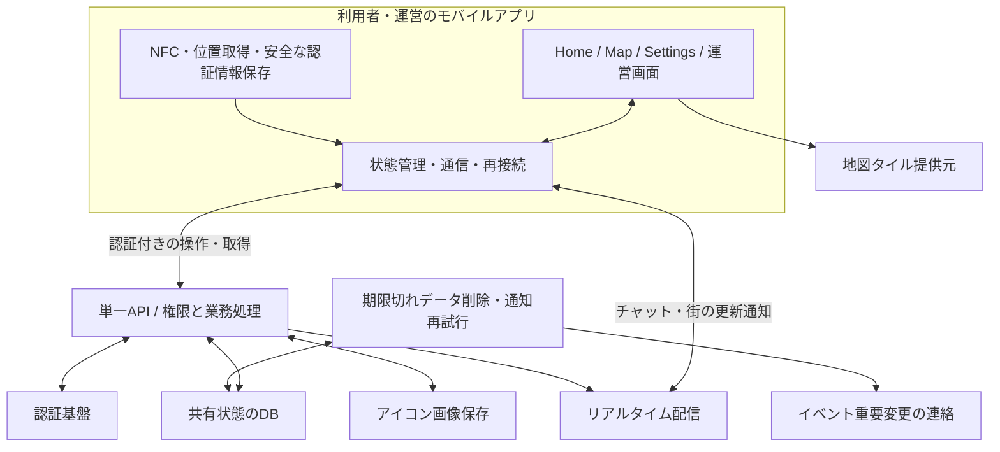

# yumegaoka — 全体構成・責務の設計案 v0.1

2026-10-29。レビュー用の提案。要件の根拠は [MVP_REQUIREMENTS.md](MVP_REQUIREMENTS.md) と [DECISIONS.md](DECISIONS.md)。単一バックエンドと、気配の街内判定・区画化を端末で行うA案は2026-10-29承認済み。後続のL/V/N/E/C/G/Kの承認済み設計を優先し、それ以外の具体方式は提案。バックエンド基盤はSupabase＋PostgreSQLを採用済み（詳細はTECH_STACK_PROPOSAL.md）。クラウド契約は未実施。本体はローカルSupabaseのRPC・Realtimeと端末モジュールを部分実装済み。実装範囲はMVP_IMPLEMENTATION_AUDIT。

## 1. 設計の軸

街で普通に過ごすだけで気配が生まれ、会話や募集を義務にしない。端末は観測と表現を担当し、サーバーは共有状態の整合性とアクセス権を担当する。画面がシンプルでも内部の寿命は分ける。

- アカウントへのログイン：街の閲覧・チャット・イベント利用の資格。
- 街へのチェックイン：NFCで開始する3時間の滞在。新しい街内観測の受理で延長。
- 気配：その滞在の最新の観測1件。観測から10分で失効。
- 募集：利用者が明示公開した固定位置。20分、または滞在終了で終了。
- イベント参加：将来の予定。街への入退場とは独立。

## 2. 単一バックエンド（採用済み）と内部構成案

最初は単一のバックエンドに論理的な担当を分ける。マイクロサービスや独立した気配サーバーは設けない。以下は製品名ではなく責務の図。

APIと配信とジョブは別サービスへの分割を意味しない。管理型基盤にまとめるか、自前の処理をどこに置くかは、この責務を満たせる候補から選ぶ。運営画面を同じアプリに入れる案は未確定だが、NFC書き込みはiPhone上で行う。

## 3. フロントエンドの責務

| 層 | 担当 | 守る境界 |
| --- | --- | --- |
| 表示 | 地図、気配の人数とフェード、チャット、ピン、詳細シート | 表示用アイコンを個人の追跡キーにしない。7人を5＋2に描いても観測位置・人数は変えない |
| 操作・状態 | 入街処理中、有効、退出反映待ち、失効、通信切断、フォームの下書き | アカウントログインと街チェックインを別管理。通信中を成功扱いしない |
| 観測 | OS位置情報、NFC読み取り、運営のNFC書き込み | UIを閉じても必要な処理が動く構成。観測と送信の頻度は分ける |
| 通信 | 認証、コマンド送信、購読、再接続、重複整理 | 期限・権限の最終判断はサーバー。全画面から個別に接続を増やさない |
| 端末保存 | 認証情報、未反映の退出意思、必要な再送識別子 | 位置履歴を蓄積しない。機密を通常ログへ出さない |

気配更新は画面コンポーネントから独立させる。合意済みの次の試作では距離フィルターを外し、新しい測位が得られたとき、区画移動または同一区画で前回送信から約3分経過なら送る。タイマーで古い座標を延命しない。現在の間隔・境界対策はOBSERVATION_RULESとFIRST_SLICE_CONTRACTを参照する。

オフライン時の位置を全件キューにためず、最新の新鮮な候補だけを扱う案。退出意思は別に保持し、再接続時に位置更新より優先する。退出後に遅れて到着したOSコールバックも破棄する。

## 4. バックエンドの責務

| 担当 | 処理 |
| --- | --- |
| 認証・招待 | ログインの検証、招待の期限と単回消費、停止ユーザーの拒否 |
| 街・ステッカー | 有効タグ、設置位置、街範囲の版、移設・撤去・交換 |
| 滞在・気配 | NFC開始、更新の鮮度・順序・所有者、退出、期限、最新1件の置換、人数集計 |
| ピン・イベント | 所有者の編集権限、募集の滞在条件、定員と参加の同時処理 |
| チャット・運営 | 履歴取得、投稿制限、通報、削除、利用停止、運営権限 |
| 配信・連絡 | 確定した変更の通知、再接続時の取り直し、重要連絡の再試行 |
| 保存管理 | 公開期限とは独立した物理削除、証拠の分離、ログ・バックアップの管理 |

運営用画面を隠すだけで権限制御しない。すべての操作でサーバーが本人・所有者・運営権限を検証する。イベント参加者一覧は主催者・運営と本人に必要な範囲だけ公開する。

## 5. 保存する情報と返す情報

| 情報 | 内部で必要なもの | 他利用者への公開 |
| --- | --- | --- |
| アカウント | 認証との対応、名前・アイコン、利用制限 | 名前・アイコン等の公開プロフィール。メール・認証情報は非公開 |
| 滞在 | 所有者、街、開始・期限・終了、更新順序 | 街の有効チェックイン人数。別途、合意済みの名前付き入街ログ |
| 気配 | 滞在ごとの最新区画・観測時刻・期限 | 区画単位の人数・描画に必要な鮮度。滞在ID・個人トークンは返さない |
| 募集 | 所有者、滞在との対応、明示公開した座標・題名・期限 | 公開位置、募集内容、募集者。個人位置を示すことを作成時に確認 |
| イベント | 主催者、日時・場所・内容・定員・状態 | イベント内容、主催者、参加人数 |
| 参加登録 | イベント・アカウントの対応 | 主催者・運営には一覧、本人には本人の状態。他人には人数だけ |
| チャット | 投稿者、本文、時刻、削除状態 | 投稿者と本文。30日範囲、削除・制限を反映 |
| 招待・通報 | 招待関係、通報内容、証拠、対応 | 必要な当事者・運営だけ。通報者を一般公開しない |

気配は端末で街内判定し、生座標を区画IDに変換して送るA案を採用。気配更新の生座標はサーバーへ送らない。ただし、この場合サーバーは正確な街内位置を独立検証できない。最新の街範囲を端末へ渡し、その版と区画の妥当性をサーバーで検査するが、位置の偽装防止にはならない。サーバーに生座標を一時受信させるB案は採用しない。募集ピンの本人が明示公開した位置、イベント地点、運営のタグ設置座標は別用途として保持する。

サーバーに価値あるデータがない設計ではない。メール、現在の区画との対応、チャット、今後の参加予定、招待関係は保護対象。公開の集約だけでは、少人数や入街ログとの相関による推測も完全には防げない。

## 6. 気配更新の一連の処理案

1. NFCの情報を認証付きで送る。有効タグと利用資格を検証し、新しい滞在を作る。開始操作の再送では滞在・入街ログを重複生成しない。
2. 端末が新しい位置を観測。街範囲・精度・鮮度を評価し、更新条件を満たせば滞在識別子、更新番号、観測時刻、区画、範囲の版を送る。更新元はL01のAuthセッション方式を用いる。
3. サーバーは所有者と有効滞在、サーバー時刻で3時間期限内か、順序・重複・観測の古さ・未来時刻・範囲版を確認する。端末の時計・測位値を無条件には信じない。許容誤差はOBSERVATION_RULESで具体化済み。
4. 一つのトランザクションで最新気配を置き換え、滞在期限を受理から3時間へ延長する。気配の期限は観測から10分。区画AからBに移ればAの寄与は消える。
5. DB確定後に街の変更を配信する。通知を逃しても次の取得で復元できる。公開配信に内部滞在レコードを流さない。

同じ更新の再送には再延長せず、既処理であることと現在の状態を返す案。古い更新番号は反映しない。再起動時の番号復元と更新元端末の管理は詳細設計で決める。意図的な複数端末水増しを対象外にしても、通常の再送重複は防ぐ。

退出と更新は同じ滞在の状態を直列化して処理する。更新が先ならその後の退出で終了、退出が先なら更新を拒否する。存在しない滞在への更新で新規作成しない。更新APIが滞在を勝手に作れるupsertにはしない。

## 7. 期限と画面への反映

| 条件 | 気配 | ヘッダー人数 | 募集 |
| --- | --- | --- | --- |
| 気配更新成功 | 最新1件、観測から10分 | 滞在を受理から3時間に延長 | 作成から20分のまま |
| 10分間新しい観測なし | 集計・表示から除外 | 滞在が有効なら残る | 自分の期限と滞在条件に従う |
| 滞在失効・退出 | 除外 | 除外 | 終了 |
| 通信不能の手動退出 | 端末は即停止、サーバーは通知到着または期限まで残り得る | 同左 | 同左、最大でも既存の有効期限 |

ヘッダーの有効チェックイン人数と地図の気配人数は一致しなくてよい。両者が表す期間が異なるため。

期限は取得・集計時に必ず評価し、削除ジョブの遅れに依存しない。配信がなくても画面側で古い気配を期限に合わせて消す。公開の集計に使う時間粒度とフェード情報は要設計で、個人単位の時刻列をそのまま配らない。更新が止まっている画面は最新と断定しない。

## 8. 通信と整合性の最小方針案

- 操作・履歴取得は通常のリクエスト、街の変化は認証付きリアルタイム接続。初回・再接続時はスナップショットを取得する。
- チャットはメッセージIDで重複整理し、未送信・送信中・確定・失敗を分ける。保存前に成功表示しない。
- イベント参加はイベントとユーザーの組を一意にし、残り1席への同時申込を同じDB処理で制御する。
- イベント重要変更と送信待ち通知を同じDB処理で記録する案。アプリ内＋PushはE01で採用済み。2026-11-01にAPNs直接配信を採用。実装/未確認境界はPUSH_DELIVERYを参照。配信失敗で編集自体を巻き戻さず再試行し、重複連絡を抑える。
- 人数カウンターの独立した加減算を正本にせず、有効な滞在・気配から再集計できる設計にする。
- ログに位置・トークン・本文を出さない。最新行の上書きでもDBの履歴・バックアップには古い値が残り得るため、「最新1件＝全保存層から過去位置消滅」とは説明しない。バックアップ対象・保持期間を選定時に確認する。

## 9. 技術選定で比較する条件

1. React NativeからNFCの読み書きと背景位置処理をまずiPhoneで組み込めること。Androidは将来移植対象で、現在の比較・検証の必須条件にしない。Swift試作の成功だけで製品の背景動作を保証しない。
2. 権限分離、トランザクション、一意制約、期限付き取得が実装しやすいDB/API構成。
3. 認証・メール復旧を少ない独自実装で扱え、招待条件と利用停止を強制できること。
4. チャット配信と再接続、公開データの選別を扱え、DB内部レコードを無条件配信しないこと。
5. 定期削除・通知再試行、ログ制御、バックアップ保持を管理できること。
6. MapLibre用の地図タイル、画像保存、重要変更通知の費用と運用負担。

基盤はSupabase＋PostgreSQLを採用済み。料金プラン・配置・ライブラリ互換性・実装詳細は引き続き確認する。

データ・状態・競合処理の具体案は [DATA_MODEL_AND_STATES.md](DATA_MODEL_AND_STATES.md)。未承認案としてレビューする。

## 10. 次に確認する設計判断

- Supabase＋PostgreSQLと端末区画化を前提にした認証・配信・API/DB分担・プランの具体化。
- 気配の区画サイズ・境界誤差・移動時の送信上限と揺れ対策。
- イベント重要変更はアプリ内＋APNs直接Pushで確定。外部接続・配布条件はT019/T033で扱う。
- 採用済みメールOTPの設定、更新元端末の所有、入街ログとイベント登録の削除期限。

実装は、認証・招待 → NFC滞在 → 気配更新・地図表示・退出をまず一巡させ、その後に募集・チャット・イベント・運営機能を接続する案。各段階で通信断と期限切れを扱う。静止中調整は開発中の確認項目として残し、Android確認は将来移植時へ延期し、独立した長期検証を開始しない。
