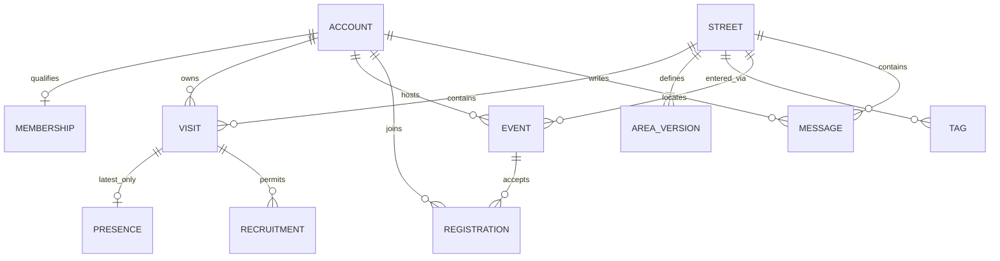
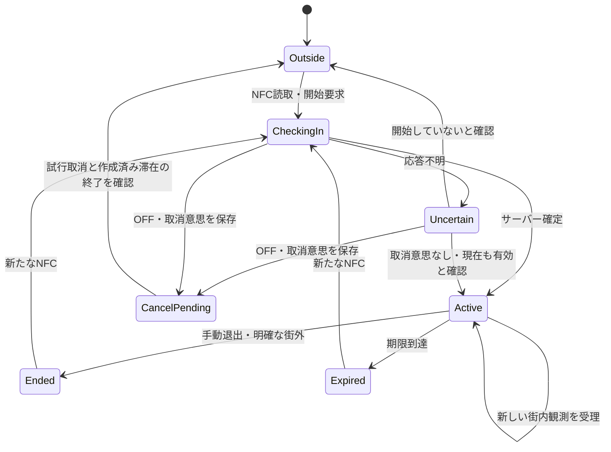

# データモデル・状態遷移案 v0.1

2026-10-29。**全体モデルの設計案。滞在・気配のSQL/APIは部分実装済みだが、以下の全テーブルが存在するわけではない。** 実テーブルと呼出関係は[MVP_IMPLEMENTATION_AUDIT](MVP_IMPLEMENTATION_AUDIT.md)。 正本は [要件](MVP_REQUIREMENTS.md)、対応する確認条件は [R01〜R22](ACCEPTANCE.md)。以下のテーブル名・制約・処理方式は提案。D01の1滞在1更新端末・別端末ログインによる自動移行なしは承認済み。D03の利用停止時終了と入退場例外5項目も承認済み。D04・D05と終了後24時間以内の参加登録削除も承認済み。Authセッションによる更新元識別と入街の有限受付期限はL01/L02で承認済み。他の作成要求の期限は未承認。追加レビューは [DATA_MODEL_REVIEW.md](DATA_MODEL_REVIEW.md)。

滞在部分の具体案は [VISIT_LIFECYCLE](VISIT_LIFECYCLE.md) に統合。L01〜L04を承認済みとして明示し、本書の未決定箇所を具体化している。全体モデルの要件を自動変更するものではない。

## 1. 分けて管理するもの

認証、利用資格、街の滞在、気配、募集、イベント参加を一つの「ログイン状態」にしない。メール認証できても招待資格がない場合がある。利用資格があっても街にいない場合がある。街にいても観測が途絶えて気配が消える場合がある。イベントへの参加は現地にいる証拠ではない。

図は論理関係。認証メールを公開プロフィールへ複製しない。運営の権限、投稿停止、利用停止、プロフィール完成状態も分離する。

## 2. 論理データモデル案

IDは推測困難でも、それだけで操作資格を与えない。日時はタイムゾーンを含む時点として保存し、表示で日本時間等へ変換する。下表は主要フィールドであり完成DDLではない。

| データ | 主な情報・制約案 | 保存・公開上の境界 |
| --- | --- | --- |
| accounts / profiles | Authユーザーとの一意対応、表示名、画像参照 | メールは認証基盤。表示名を本人確認キーにしない。プロフィール未完成を利用資格と混同しない |
| memberships / restrictions | 招待登録資格、停止状態・期限、権限 | JWTの古い情報だけで停止判断しない。毎操作で現在の資格を検査 |
| invitations | 発行者、秘密コードのハッシュ、期限、使用者・使用時刻、失効時刻 | 7日・1回。招待コードの平文を通常ログに保存しない |
| streets / area_versions | 街ID、現在の範囲版、境界、区画定義版 | 公開された版は不変にし、現在版への参照を切り替える。区画IDは街・区画定義版と組で解釈 |
| tags / placements | タグID、有効状態、設置場所、街との対応 | 位置とタグを分離。設置座標は気配の生座標禁止とは別用途 |
| visits | ID、所有者、街、開始タグ、開始時刻、期限、終了時刻・理由、更新元、最終順序・観測時刻 | 人数の正本。更新元識別はL01のAuthセッション。終了後最小情報は24時間で削除 |
| presence_current | visit_idを主キー、街・区画定義版・区画、観測時刻、期限 | **1滞在0〜1件**。最新区画のみ。個人行は公開しない。退出時に削除、自然失効後1時間以内にライブDBから削除（L04） |
| recruitment_pins | 所有者、visit_id、公開地点、題名、作成・期限・終了・版番号 | 同時1件。20分固定。滞在終了で非表示。本文・座標は終了後24時間以内に削除 |
| events | 主催者、街、日時、地点、内容、定員、中止時刻、版番号 | 上限3件・90日先・24時間。終了を編集で復活させない案 |
| event_registrations | event_idとaccount_idを一意、参加/取消、版番号 | 名簿は主催者・運営、本人は自分のみ。取消済み行の最小状態保持はD04 |
| messages / arrival_logs | 街、投稿者、本文/種類、作成・削除時刻。入街ログはvisit_idを一意対応 | 普通のチャット・名前付き入街ログとも30日（C01）。期限延長で再投稿しない |
| blocks / reports / moderation_audit | 対象ID、通報証拠、制限、運営操作 | 通報証拠は限定アクセス。ブロックの作用はC02。未対応通報の最長保持期限は未決定 |
| command_receipts | 操作者、操作種別、要求ID、結果対象ID、有効期限等の最小情報 | 無制限の要求本文・座標・履歴を保存しない。気配は最終順序だけで済ませる案 |
| notification_outbox | イベントID・版・通知種別、必要な宛先、処理状態 | イベント変更と同時に登録する案。気配の位置履歴を入れない。宛先の削除期限は参加登録と合わせる |

メール認証からDBの利用資格作成までを一つの外部サービス横断トランザクションとは扱わない。Authだけ存在する途中状態を許し、招待消費とmembership作成は同一DB処理にする。プロフィール設定を再開できる。招待の取り合いでは片方だけ成功し、敗者には街の資格を与えない。

## 3. 有効性を一か所で定義する

以下は述語の設計案。取得・更新・配信対象生成が同じ条件を使う。単なるstatus列や削除ジョブの実行結果だけで判断しない。

- 有効滞在：利用資格有効、ended_atなし、判定時刻 < visit.expires_at。
- 有効気配：有効滞在に属し、判定時刻 < presence.expires_at。期限は観測時刻＋10分（滞在期限も上限）。
- 有効募集：有効滞在に属し、募集ended_atなし、判定時刻 < 募集期限。
- 公開イベント：中止・運営非公開でなく、判定時刻 < ends_at。受付可能かはこれと別。
- 街の人数：有効滞在の数。地図人数：有効気配の区画別合計。両者は一致しなくてよい。

期限ちょうどは失効とする案。削除を待たず読み取りから除外する。DBにactiveという値が残っていても期限後は有効にしない。イベント開催前/開催中/終了は時刻から求め、満席は参加数と定員から求める。満席を永続状態にして取消後も満席のままにしない。

利用停止解除で昔の滞在が再び有効になる問題を避けるため、利用停止時に既存滞在を終了させる（D03承認済み）。投稿だけの制限と利用停止を区別する。

## 4. 滞在と気配の遷移

上図のCancelPendingの振る舞いは承認済み。開始試行IDを対象に取消と開始を直列化し、取消が先なら生成を拒否、開始が先なら作成済み滞在を終了する。古い成功応答でONへ戻さない。オフラインでは反映待ちとなる。具体APIは未承認。

同じ滞在IDのEnded/ExpiredからActiveへは戻さない。再入街は新しい滞在。気配だけの期限切れなら、有効滞在の新しい観測で再表示できる。L03により位置権限拒否では入街不可、一時的な測位不能なら滞在のみ開始し、初回観測まで気配なし。タグ位置で勝手に気配を作らない。

### 更新処理案

1. サーバーで認証と招待資格を確認。操作元のaccount_idをクライアント本文から信用しない。
2. 対象の資格・街範囲・滞在に必要なロックを取り、待機後に判定時刻を取得する。
3. 所有者・更新元・期限・終了・範囲版・区画ID・新鮮さ・順序を検証する。鮮度は受理まで120秒以内を採用。時計補正・許容未来幅はQ03。その他の観測条件は要件4章を参照。
4. 一つのDB処理でpresence_currentを置換し、visitの最終観測・順序と期限を更新する。受理時刻から3時間、気配は観測から10分。
5. 確定後、公開情報を更新する通知を送る。応答はvisitの現在状態・版・サーバー時刻・期限等。公開購読には個人の滞在IDを含めない。

新しい順序番号でも古い測位時刻なら拒否する。端末時計は現地証明ではなく、A案の申告依存は残る。未来時刻をそのまま採用して期限を延長しない。

更新番号は気配行を削除してもvisitに残す。これを気配行だけに持つと、10分失効後に古い再送を新規観測として通してしまう。端末の再起動・クラッシュで番号が戻った場合は、サーバーの最終番号と同期してから新しい観測を送る。1滞在の更新元端末は一つに限定し、別端末ログインで自動移行しない（D01承認済み）。writer_idの自己申告ではなくサーバーで検証できる認証セッション等との対応が必要。検証済みAuthセッションIDを用いる方式を採用（L01）。通常のトークン更新は維持、新しいログインセッションでは再NFC。

### 終了と競合

退出も更新も同じ滞在行をロックする。更新→退出なら最後に終了、退出→更新なら更新拒否。募集の作成/編集も同じ滞在の検証に参加させ、退出と競合して終了後に公開されないようにする。

オフラインOFFは端末に退出意思を先に保存し、観測・送信を止める。未反映退出は当該visit_idだけに送る。古い退出通知で新しい滞在を終了させない。退出をサーバーが知る前に処理中更新が通る可能性は残り、即時公開終了は保証しない。再接続では退出を先に解決し、古い位置キューを再生しない。

### 端末切り替えとログアウトの具体化（方式は提案）

旧滞在終了と新滞在作成は同じアカウントを保護するDB処理で一体化する。新規開始が失敗したのに旧滞在だけ終了する部分成功を避ける。同端末の再タッチか新端末かは、検証済みの更新元で判断する。切り替えの再送は新しい切り替えとして実行しない。端末A/Bが同時に再NFCする場合の順序制御も必要で、終了した旧滞在の成功応答を最新状態として返さない。

ログアウトではまず観測・送信を止め、可能なら認証情報の破棄前に対象滞在の終了を送る。通信不能でもログアウト自体を無期限に妨げず、期限での失効を許容する。終了通知のために無断で汎用ログイン資格を残したり、無認証退出APIを設けたりしない。別端末のログアウトが現在の更新端末の滞在を消さないよう対象を限定する。いずれも具体方式はQ01/Q04で確認する。

## 5. 再送・タイムアウト・古い操作

| 操作 | 重複/順序制御の案 | 応答不明時 |
| --- | --- | --- |
| 入街開始 | 開始要求IDを固定、同じ試行で滞在・入街ログを一つだけ生成 | 新要求で開始せず同じIDの結果確認。受付可能時間を過ぎた要求は再実行せず再NFC（D02） |
| 気配更新 | visitごとの単一更新元＋増加順序＋新鮮な観測時刻 | 同じ番号の再送は延長しない。既処理か現在状態を返す |
| 退出 | 対象visitの終了は繰返しても同じ結果 | 不在でも新規作成せず終了済み扱い。所有者を検証 |
| 募集・イベント・投稿作成 | 操作者＋種別＋要求IDを一意にする | 成功結果を再取得。二重作成を防ぐ |
| 募集/イベント編集 | 対象の版番号を指定、古ければ競合を返す | 古い内容で新しい編集を上書きしない |
| 参加/取消 | 登録行を一意、操作IDと登録版を確認（D04） | 遅れた「参加」で取消を復活させない |

要求IDだけでは永久に再送を防げない。重複記録を削除した後の古い作成要求を受け付けないため、作成系の要求にはサーバー側で判定できる有限の受付期限を設け、重複判定情報をその期限以上保持する案（D02）。入街はサーバー発行から2分、最小記録は受付期限後24時間で削除（L02承認済み）。他の作成APIの具体時間は未承認。単純なupsertで不在のvisitを生成しない。

同じ要求IDで内容が違う場合は拒否する設計が必要。ただし、気配ごとの区画をハッシュにして長期保存すると候補の少ない区画を推測できるため、位置履歴の代わりに全要求ハッシュを蓄積しない。気配は最終番号以下を反映しない方式に寄せる。

## 6. 募集とイベント

### 募集

所有者単位のロックで同時1件を守り、滞在をロックして有効性を再確認する。期限切れの古い募集を終了扱いにしてから新規作成する。現在時刻を使った動的な一意制約だけに依存しない。題名編集は座標・作成時刻・期限を変えない。

滞在の自然失効で募集が終わった場合の削除期限は、ジョブが発見した時刻ではなく、実際の失効時刻から算出する。公開が終わっても本文・座標が無期限に残らない。新しい募集を立てるときの通常の作成頻度制限も残す。

### イベント

時刻による開催段階、受付状態、満席、中止を独立して扱う。参加数は有効登録行から求める案。定員判定・参加/取消・主催者編集/中止は同じevent行をロックし、確定済みの数を見て処理する。

最後の1席では、Aを登録して確定してからBが最新人数を確認し、Bは満席で拒否される設計を目指す。ロックだけでは不十分で、Read Committed下で親ロック取得後の別SQLにより集計する等、最新の確定結果を読む方式を統一する（F04）。同じSQLや古いスナップショットの集計を使わない。単純な「人数取得→後でinsert」にはしない。ロック対象が存在しない新規登録は、親eventをロックして一意制約と併用する。

中止後の参加要求は拒否。イベント編集では版番号を要求し、開催終了後にends_atを書き換えて復活させない。終了・中止後は新規イベントとして作成し、定員を参加済み人数未満に減らせない（D05承認済み）。開催中も空きがあれば参加可能。終了・中止後は参加不可。本人は終了まで取消でき、空いた席は再募集する。主催者による個別除名はE02でMVP対象外。

変更通知はイベント変更と同時に最小限の通知待ちを登録する案。送信失敗を理由に参加・編集を何度もやり直さない。送信処理は再試行可能にし、イベント版＋受信者＋通知種類で重複を抑える。ただし外部通知は完全な一回配信を保証しない。参加登録は終了後24時間以内に削除する。通知待ちの宛先に参加関係を無期限に複製しない。中止時は中止時点から24時間以内に参加登録を削除し、中止連絡もこの期限に合わせる。宛先の削除・再試行打切りの具体方式はQ08で決める。

## 7. ロック・時刻・権限の実装方針案

- API→DBの複数呼び出しを一つのトランザクションと誤認しない。整合性が必要な単位はDB関数1回で処理する。
- PostgreSQLの現在時刻にはトランザクション開始時刻を返すものがある。長くロック待ちした要求が、古い時刻を根拠に期限後の滞在を延長しないよう、必要なロック取得後に判定用時刻を一度取得する。返却する「受理時刻」はこの判定時刻と定義する案。
- 共通の取得順を定義する：アカウント/資格の保護用親行（複数ならID順）→街の現在版（必要時）→対象の招待/滞在/イベント→子行。通常操作の資格・街版読み取りは共有ロック、停止・範囲公開は排他ロックを検討。運営停止は親の資格を先に取り、停止後の子更新と整合させる。
- 日時・期限・状態を確認した後、DB処理中に外部メール送信やネットワーク呼出しを挟まない。デッドロック・競合再試行は同じ要求IDで上限付き。完了前に成功通知しない。
- RLSだけで業務の期限・人数・競合処理が完成するわけではない。認証された通常利用者でも直接テーブル更新できない境界を設ける。DB関数の実行権、所有者、search_pathも限定する。
- service_role等の強い権限で接続する処理はRLSを回避できる場合があるため、リクエスト本文のユーザーIDを信用せず検証済みの主体で処理する。SQL・APIごとに越権確認する。

資格行がまだ存在しない初回登録では、その不在行にロックを掛けたつもりにならない。先に確保したアカウント親行と招待行を使って直列化し、一意制約を併用する。招待・募集・イベントの発行上限も、別々の要求が同時に上限直前を見ないよう発行者の親行で整合させる。ロックを長時間保持しないため処理時間と待機時間に上限を設ける。具体値は未決定。

期限切れ気配の削除と新しい観測の更新も競合する。削除ジョブは古いSELECT結果のIDだけを使って無条件削除せず、削除時点で期限条件を再確認する。更新で新鮮になった気配を後から消さない。どちらの順でもvisit側の更新番号を残す。

## 8. 公開データと削除

F05の追加提案：端末は操作世代・対象visit・サーバー状態版を照合し古い応答を捨てる。公開スナップショットも取得世代/版で逆順を防ぎ、購読開始と初期取得の隙間、通知欠落を再取得で回復する。個人の更新番号を公開APIへ追加しない。

F03の注意：private channelの権限は接続中キャッシュされ、利用停止後もJWT更新/失効等まで受信できる場合がある。APIの資格確認と配信停止は別。変更通知＋資格確認付き取得を候補にするが、通知時刻も隠す必要があるかはQ09で確認する。

F06の追加提案：気配・募集の街と所有者は親滞在から導出するか、複合外部キーで一致を強制する。区画は街・区画定義版と組で検証。旧版気配を新しい区画へ勝手に読み替えない。

内部のpresence_currentは一般利用者へ直接SELECT/購読させない。APIは区画ごとの人数と必要な鮮度だけを返す。個人のID、安定したアイコンキー、最終順序は公開しない。

公開集約の例として「区画＋短い時間帯ごとの人数」を返す案はあるが、時間の丸めで早期消滅や詳細推測が起こり得る。人数とフェードをどう両立するかはQ05で別途設計し、このモデルだけで解決済みとしない。新しい人の更新で古い人の期限をまとめて延長しない。

イベント名簿、メール、通報者は公開ペイロードから除外。本人が得る参加状態は自分の行のみ。一般利用者の参加人数取得と名簿取得を別の権限にする。

削除ジョブが遅れても有効性判定は期限で止める。物理削除は公開終了時刻から要件の期間内に行う。外部キーの一括削除で、名前付き入街ログや通報証拠を意図せず消したり、逆にログの外部キーのため終了visitを24時間で消せなくなったりしないようにする。ログの識別に必要な最小情報と滞在レコードを分離する。保存期限未決定のものを無期限保存としてDDL化しない。

## 9. 競合・異常系のレビュー表（未実行）

| シナリオ | 必須の結果 | 対応要件 |
| --- | --- | --- |
| A区画更新の後に古いB区画更新が到着 | 新しい順序・観測を維持、気配は1件 | R07 |
| 気配が消えた後、同じ観測を再送 | 再表示・再延長しない。visit側の最終番号で拒否 | R05/R08 |
| 退出と更新が同時 | どちらの処理順でも最終的には終了 | R06 |
| 滞在期限直前に要求、ロック取得は期限後 | 延長拒否。端末の送信時刻を期限判定にしない | R05 |
| 応答紛失後に入街再送 | 滞在・入街ログは1件。旧要求が後日に再実行されない | R04 |
| 募集作成と退出が同時 | 退出確定後に募集が公開されない | R06/R12 |
| 同時に2件募集を作成 | 同時公開1件。失敗で入力を失わない | R12 |
| 新しい滞在開始後に古い退出が到着 | 新しい滞在を終了させない | R04/R06 |
| 最後の1席へ同時参加 | 登録数が定員を超えない | R13 |
| 参加→取消後に古い参加が到着 | 参加を復活させない | R13 |
| イベント中止と参加が同時 | 中止後は参加受付せず、先に参加した人の中止反映も整合 | R13 |
| 最新範囲への変更と旧版観測が同時 | 旧版なら更新を保留して最新取得へ。変更だけで退出しない | R11 |
| 配信切断・通知欠落 | 再取得で正しい状態へ。取得済み期限で古い気配を消す | R08/R15 |
| Auth成功、招待消費に失敗 | 街の閲覧・投稿権限を与えない | R03 |
| 一般ユーザーが名簿/内部気配/運営APIを直呼び | 非公開情報を返さず操作を拒否 | R10/R14/R18 |
| 削除・バックアップ復元 | 期限切れや停止状態を復活させない | R17 |

これは設計上の机上レビューであり、通過したテスト一覧ではない。実装時に並行DBトランザクション・応答紛失・再接続で確認し、結果をACCEPTANCEへ記録する。

## 10. 合意状況と残る提案

- **D01 承認済み / Q01・Q04：1滞在につき更新する端末を一つに限定。** 他端末でログインしても自動的に滞在を引き継がない。新端末で再NFCした場合は旧滞在・旧気配・旧募集を終了し新しい滞在へ切り替える。同端末再タッチは有効滞在を重複生成しない。意図的な水増し対策とは別の競合防止。
- **D02 / Q04：新規作成要求の再試行可能時間を有限にする。** 時間超過や処理結果不明が解消できない場合は再操作へ。NFC開始を後日再送して再入街させない。入街はL02で2分の受付期限を採用。具体APIはVISIT_LIFECYCLEを参照。他の作成操作は引き続き設計対象。
- **D03 承認済み / Q09：運営の利用停止時は有効滞在と募集を終了する。** 解除だけで再参加させず再NFC。投稿制限だけなら滞在を終了しない。ログアウトは当該端末が更新する滞在を終了し、通信断では観測・更新を停止して既存期限による失効を許容する。
- **D04 承認済み / Q07・Q08：イベントが有効な間は、取消済み登録の最小状態を保持する。** 過去参加履歴画面は作らず、遅延した参加要求による復活を防ぐ。終了後24時間以内に参加登録情報を削除する。通報証拠は既存の別管理ルール。中止時は中止時点から24時間以内に削除。通知宛先の削除・再試行打切りはPINS_AND_EVENTS_DESIGNを参照し、未解決部分だけQ08に残す。
- **D05 承認済み / Q07：定員を参加済み人数未満には減らせず、終了・中止したイベントは再開せず新規作成する。** 参加者を黙って落とさない。開催中も空きがあれば新規参加でき、終了・中止後は不可。本人の取消は終了まで可能。

## 一次資料（2026-10-29確認）

- [PostgreSQL ロック](https://www.postgresql.org/docs/current/explicit-locking.html)：行ロック・競合・デッドロック。
- [PostgreSQL 時刻](https://www.postgresql.org/docs/current/functions-datetime.html)：transaction/statement/clockの違い。
- [Supabase DB関数](https://supabase.com/docs/guides/database/functions)：関数と実行権・security definerの注意。
- [Supabase RLS](https://supabase.com/docs/guides/database/postgres/row-level-security)：行権限とバイパス権限の注意。

公式APIの機能と、この設計が正しく実装されることは別。具体SQL・インデックス・ロックモードは実装レビューで検証する。
