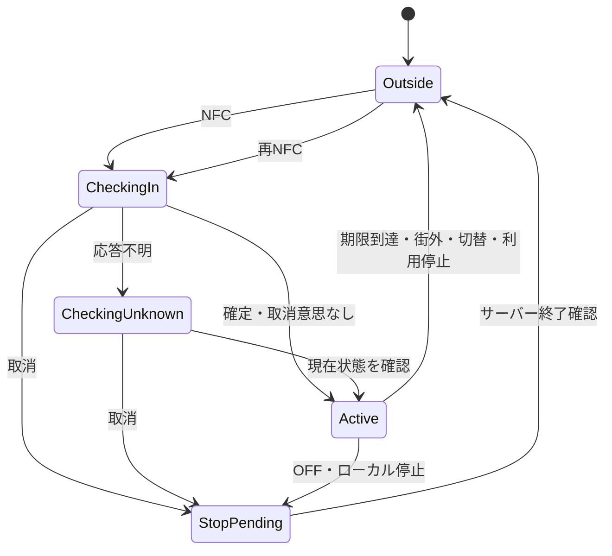

# チェックイン・気配更新・退出の詳細設計案 v0.1

2026-10-29。**承認済み条件に沿って製品コード・SQLを部分実装。実行証拠はTECH_VALIDATION。クラウドは未作成。**

対象：R03〜R12、R17、R18、R21、R22。要件の正本は [MVP_REQUIREMENTS](MVP_REQUIREMENTS.md)。本書は [全体モデル](DATA_MODEL_AND_STATES.md) の滞在部分を具体化する。承認済みの振る舞いは変更しない。下記L01〜L04は2026-10-29に承認済み。他の内部処理は設計案であり、4点の承認を文書全体への包括承認とは扱わない。具体DDL・実DBの競合試験は実装時に行う。

## 1. 守る条件

1. 一つの滞在には更新元が一つ。ログインだけで更新元を移さない。
2. 一つの滞在の気配は最大1行。移動は追加でなく置換。位置履歴テーブルを作らない。
3. 有効滞在は3時間、有効気配は観測から10分。通常モードは気配更新成功と滞在延長を同じDBトランザクションで行う。11月5日承認のゴーストでは新しい街内観測で滞在のみ延長し、区画を送信/保存しない（MAP_REDESIGNの採用仕様）。
4. 退出・失効した滞在は復活しない。不在の滞在への更新で行を生成しない。
5. 古い要求・重複要求で期限を延ばさない。気配の削除後も最終更新番号は滞在に保持。
6. 人数は有効滞在から数える。独立した人数カウンターへ単純に加減算しない。
7. 気配・募集の公開は親滞在の有効性にも依存。掃除ジョブが止まっても期限後は公開しない。
8. 個人の滞在ID・更新元・順序番号を街の公開応答に含めない。

有効性の判定時刻を `t` とすると、期限ちょうどは無効とする設計。

- 滞在有効：利用資格有効 AND 終了なし AND `t < expires_at`。
- 気配有効：滞在有効 AND `t < presence.expires_at`。
- 募集有効：滞在有効 AND 募集終了なし AND `t < pin.expires_at`。

## 2. 承認済みの4点（2026-10-29）

| ID | 採用内容 | 体験・保存への影響 |
| --- | --- | --- |
| L01 | 更新元を、検証済みJWTのAuthセッションIDに結び付ける。通常のトークン更新では維持。ログインし直してセッションが変わった場合は同じiPhoneでも再NFC | 端末専用の独自秘密鍵を追加せずMVPを簡潔にする。物理端末そのものの証明ではない |
| L02 | NFC読取後の開始試行はサーバー発行から2分以内に確定。超えたら再タッチ。同端末の有効滞在への再タッチだけでは延長しない | 後日届いた開始要求を拒否。処理済みなら期限後も結果照会できる。開始試行の最小記録は受付期限後24時間で削除 |
| L03 | 位置権限を拒否している場合は新規チェックインさせない。権限があって一時的に測位できない場合はNFCで滞在のみ開始し、初回観測まで気配は作らない | タグ位置で人を捏造しない。閲覧・チャットは継続可。背景権限不足は説明し、設定案内と欠測表示を出す |
| L04 | 気配は退出時に同じ処理内で削除。自然な10分失効では即非公開とし、ライブDBの行は失効後1時間以内に削除 | 最終区画の不要な保存を短くする。これはライブDBの目標で、WAL・バックアップからの即消去保証ではない |

L02は全体モデルD02のうち入街操作を具体化したもの。他の作成APIの受付期限まで一括採用しない。L03で権限許可は現地証明ではなく、端末が報告する能力状態。権限変更をサーバーが即座に知るとは扱わない。

## 3. データと責任

IDはUUID、順序・版はbigint、日時はtimestamptz。クライアントとのbigintの受け渡しは文字列とし、JavaScriptの整数精度に依存しない。状態と理由は列挙値／CHECK制約で限定する。

| データ | フィールドと制約 |
| --- | --- |
| account_visit_guard | `account_id` PK、`lifecycle_epoch`（開始・終了で増加）、`current_visit_id` nullable。利用資格の親行として毎操作でロック。一つの現行滞在を指す初期単一街MVPの設計。複数街展開時の同時参加ルールは別途決定 |
| checkin_attempts | サーバー発行`attempt_id` PK、account、writer_session、street、tag、設置版、`expected_epoch`、issued_at、accept_until、pending/committed/canceled/rejected、`result_visit_id` nullable、created/reusedの結果種別。本文を丸ごと保存しない |
| visits | `visit_id` PK、account、street、writer_session、started_at、expires_at、ended_at nullable、end_reason nullable、`revision`、`last_seq`（初期0）、last_observed_at nullable。終了時刻と理由は両方NULLまたは両方値あり |
| presence_current | `visit_id` PKかつFK、grid_version、cell_id、observed_at、expires_at。街・所有者は親から導出。区画を街・区画定義版と組で検証。個人行は非公開 |
| streets / area_versions / tags | 街の現在範囲版、変更不可の公開境界版、変更不可の区画定義版、タグ有効状態と最新設置参照。範囲版と区画定義版を分離 |
| recruitment_pins（関連） | visit_id FK、所有者を親から導出／一致制約、expires_at、ended_at。滞在終了と同じ処理で終了 |
| arrival_logs（関連） | 通常モードの新規滞在開始のときだけ1件。ゴーストでの新規滞在は作成せず、通常復帰でも追加しない。同じ開始試行の再送・既存滞在再タッチ・更新では追加しない。visit削除を妨げる必須FKにしない |

終了理由：manual、outside、expired、replaced、logout、banned、checkin_canceled。自然失効時の終了時刻はジョブ実行時刻ではなく元のexpires_at。

実装時の制約：未終了visitはaccountごとに一意（期限切れ旧行を終了にしてから新規作成）。guard参照とvisit所有者の一致を複合FK等で強制する。presenceからのFKは削除で子が残らない方式。arrival_logs・通報証拠は保存期限が別のため一括CASCADEしない。

終了滞在は既存要件どおり最小情報だけ24時間保持。開始タグとの関連は終了時に除去する設計とし、再送確認に必要なID・所有者・更新元・終了・順序等に絞る。開始試行の保持中も終了後はタグ／設置情報を除去でき、未処理試行の検証用データと区別する。入街ログは承認済みの30日表示＋24時間以内削除に従う。

## 4. API境界

以下は論理操作名。HTTPルート／RPC名は実装で対応させる。通常クライアントのテーブル直接書込みは禁止。検証済み主体を用いるDB関数1回を整合性の単位とし、Edge Functionsで行う前処理だけを権限検査の代わりにしない。

| 操作 | 入力 | 主な結果 |
| --- | --- | --- |
| prepare_checkin | 読取タグID・設置書式版 | attempt_id、accept_until、server_time。NFCを実際に読んだ後に呼ぶ |
| commit_checkin | attempt_id | created/reused/conflict/expired/canceledと現在状態 |
| cancel_checkin | attempt_id | 試行取消。そこから新規作成した滞在だけ終了 |
| get_checkin_result | attempt_id | 処理結果と現在の対象滞在状態。過去の成功応答をそのまま返さない |
| get_my_visit | なし | 本人の現在滞在、can_update、revision、last_seq、期限、範囲版、server_time。地図座標は不要 |
| observe_visit | visit_id、seq、observed_at、area_version、inside/outside、inside時のみgrid_version/cell_id | accepted/ignored/area_changed/stale/ended/expired/wrong_writer等と現在状態 |
| end_visit | visit_id、manualまたはlogout | 終了済み含め成功。同じ所有者・更新元だけ。利用停止は運営専用経路 |

account_id、writer_session、受理時刻、有効期限はサーバーが決める。任意のwriter_idを本文で名乗っても認証に使わない。ログアウトは当該セッションのみを対象とし、SDKの全セッション失効を無自覚に使わない。

`prepare`の再送で未使用試行が複数できても人数は変わらない。端末は最後に採用した試行一つだけcommitする。pending試行を作っただけでは旧滞在を終了しない。サーバー発行済みID以外のcommit/cancelから試行を生成しない。存在しないIDは再開始不可。prepareの濫用制限はAPI運用設定で設ける。

認証はJWTの署名・期限・主体だけでなく、対応する認証セッションの存在とアプリ側の現在利用資格も確認する。Auth失効の伝播とアプリDBの終了を跨ぐ完全な原子性は保証しないため、アプリのログアウト・停止では先にvisitを終了する。Auth管理操作の失効方式・時間上限はQ01に残る。

静的タグIDの送信は物理的なNFC接触証明ではない。タグ複製・改造クライアントによる虚偽位置をこの方式で解決済みとしない（Q06）。

## 5. チェックインの一連の処理

1. 端末は説明・権限を確認してNFCを読み、prepareで期限付き試行を取得。UIは確認中であり、ON確定ではない。
2. commitはaccount親を排他ロックし、試行・タグ・街版を確認。必要なロック後の時刻で受付期限と滞在期限を判定。
3. 処理済み試行なら再実行せず現在結果を返す。取り消された試行も再実行しない。
4. 未処理ならprepare時のexpected_epochと現在epochを比較。不一致ならconflict。別端末の後発操作を古い試行が上書きしない。再試行には新たなNFCを要求する案。
5. 同じ更新元・同じ街の有効滞在がある場合はreused。人数・ログ・期限を変えない。
6. それ以外は旧滞在の終了、旧気配削除、旧募集終了、新visit作成、guard切替、arrival_log作成、試行結果保存を一つのトランザクションで確定。新visit期限は判定時刻＋3時間。気配はまだ0件。
7. 端末は現在の操作世代と結果を照合し、取消意思がなければON確定。新鮮な観測で初回の気配を作る。

cancelが先ならcommit不可。commitが先ならcancelはその試行が作ったvisitだけ終了する。別の新しいvisitを巻き込まない。**reusedの試行取消はもともとの滞在を消さない。** 利用者が滞在そのものをOFFにした場合はend_visitも送る。試行取消と退出意思を混同しない。

キャンセル未送信のまま新しい入街を始めない。状態照会→取消解決→新NFCの順。試行受付期限を過ぎても作成済みvisitの照会・取消は記録保持中可能。記録削除後も古いcommitを再実行しない。更新を続けたvisitは24時間を超えて存在し得るため、試行記録がなくても本人状態を照会し、対象visitを明示して終了する。取消を解決するまで観測更新を開始しない端末では、未確認の新規visitは延長されず3時間で失効する。

## 6. 観測更新と退出

端末の測位処理は一つの直列キューへ集約。生座標は端末で街内判定・区画化し、通信には含めない。OSの新しい測位だけを使い、同一区画の約3分更新・移動時更新を行う。通信断の位置履歴を蓄積・一括再生しない。復旧後は新しい測位を取る。

更新のDB処理：

1. 認証・現在資格・writerを確認し、親→街版→visitの順でロック。時刻`t`を取得。
2. 終了または`t >= expires_at`なら拒否。expiredは終了として整理しても復活させない。
3. `seq <= last_seq`は再送／逆順として無反映。番号が新しくても観測時刻が前回以下なら無反映。無反映では気配も3時間期限も延ばさない。
4. 範囲版が古ければarea_changed。延長・退出ともせず最新範囲を返す。端末は最新範囲と新しい観測で再判定。
5. 観測の鮮度・精度・街内区画の妥当性を検査。時計補正後の観測が許容未来幅を超えれば拒否。許容内の未来値は`t`を上限に正規化し、期限を未来へ水増ししない。
6. insideならpresenceをvisit_idで置換、期限は`min(正規化観測時刻＋10分, 新visit期限)`。visitのseq・観測時刻・revision・期限`t＋3時間`を同時更新。
7. outsideなら同じ順序・鮮度・範囲検査の後でvisit終了、気配削除、募集終了。明確でない位置はoutsideとして送らず既存期限を維持。

観測条件は要件4章で承認済み：100m四方、推定水平誤差50m以内、受理まで120秒以内、移動時最短30秒、静止時約3分、初回即送信、区画境界20m、明確な街外を30秒以上離して2回。outside送信は端末でこの2回確認が成立してから行う。精度不足・街外周の判定不明では送信・延長を保留する。具体計算はOBSERVATION_RULES、製品Swiftコードと既存試験はMVP_IMPLEMENTATION_AUDITを参照する。設定は名前付きで管理し、試作コードと製品仕様を区別する。

番号は送信前に永続化し、応答不明の再送では同じ番号を使う。再起動で番号が不明なら現在状態を取得し、サーバーlast_seqとローカル番号の大きい方から再開、新しい観測にだけ次番号を付ける。古い観測に新番号を付け直さない。番号の欠番は許す。

同番号・別本文も更新しない（再受理成功ではなくignored）。全観測の本文ハッシュを蓄積しない。拒否された番号は受理済み番号として進めない。改造端末が巨大番号を送る問題は認可と入力範囲で抑え、端末申告の真正性保証とは別に扱う。

手動退出は先にローカルの退出意思を永続化し、観測と送信を停止。serverではvisit終了・気配削除・募集終了・guard解除を同時処理。退出には観測番号を要求しないので、進行中の新しい更新に負けない。退出後に旧更新が届いても終了判定で拒否する。

ログアウトは停止→認証がある間に終了を試行→当該認証を破棄。通信不能なら既存期限で失効する承認済み動作とする。終了送信のため汎用認証を隠して保持しない。通常のオフラインOFFではログインを維持し、再接続時に対象visit終了を先に送る。

## 7. 状態遷移と画面

Activeの内側に「気配あり／気配なし」がある。気配だけの10分失効ではトグルをOFFにしない。新鮮な更新で気配を再表示できる。3時間失効ではOFF、再NFCが必要。

応答不明を「失敗して何も作られなかった」と断定しない。画面はチェック中／終了反映待ちを表示し、OFF意思があるときにONへ勝手に戻さない。古い通信応答は操作世代・visit_id・revisionで排除。期限による変化はrevisionが同じでも起きるため、必ずserver_timeとexpires_atも判定する。

別端末ログインでは街を閲覧できるがcan_update=false。自分の端末が参加しているようなON表示にしない。再NFCすると旧滞在を終了することを案内する。L01では同じ端末の再ログインもこの扱いとなる。

## 8. DBの同時処理・公開境界

初期規模では、滞在関連の変更を全てaccount親行の排他ロックで直列化する。街版は共有ロック、版公開のみ排他。対象visit・試行・子行は同じ順で取得。途中で共有から排他へ昇格させない。運営停止もaccount親を先に取り、更新が停止を追い越さない。

Read Committedで親ロック取得後の**別SQL**で関連行を読む。ロック待ち前のスナップショットのまま空き・現在状態を判断しない。判定時刻はロック後のclock_timestamp相当を一度取得する。DB内で外部通信しない。

旧滞在終了＋新滞在作成は一体。更新＋期限延長も一体。障害時は全体ロールバック。デッドロック再試行は同じ試行ID／更新番号で上限付き。クライアントからの直接DML・非公開テーブルSELECTは禁止し、公開集約と本人状態取得を別の関数で返す。関数の実行権・固定search_path・Auth主体検証を実装レビュー対象にする。

地図には資格確認付き集約APIから区画別人数を返す。人数と失効予定の返却はV01で承認済み。具体応答型はFIRST_SLICE_CONTRACTを参照。個人行をそのままRealtime配信しない。変更通知は再取得のきっかけだけとし、通知欠落・再接続時は再取得する。既存Realtime接続への停止反映はQ09で別途確認する。古い画面キャッシュにも期限を適用する。

範囲変更では既存visit/presenceを一斉削除しない。次の観測で最新範囲を検証。旧気配の区画定義版を勝手に新しい版へ読み替えない。MVPの運用中は区画定義を固定する案で、境界移設と別操作にする。

掃除処理もaccount→visit→presenceの順を守る。候補を先に選んでも、ロック後に現在期限を再確認。更新済み行を古い候補一覧で削除しない。失効を実体化するときguardが同じvisitを指す場合だけ解除しepochを進める。開始・終了・切替でepochを進め、通常の観測では進めない。これによりprepare中の通常更新は妨げず、終了や切替をまたぐ古い開始だけを拒否する。

## 9. 設計確認ケース（机上レビュー、実行済みテストではない）

| ケース | 必須結果 |
| --- | --- |
| commitを2回送る／応答紛失 | 同じvisit、arrival_logも1件。期限を再設定しない |
| 同時に別試行をcommit | epoch検査で一方のみ新規開始。後着は勝手な再切替をしない |
| cancel→commit／commit→cancel | 新規開始は残らない。別の新visitを終了させない |
| 再タッチreuseのcancel | 元の滞在は維持。明示OFFならend_visitで終了 |
| visit削除後の古い更新／attempt削除後の古いcommit | 不在を生成せず拒否 |
| A→B移動／Bの後に遅れたA | 最新Bの1件、人数は増えない |
| presence削除後の再送 | visit.last_seqで拒否、復活・延長しない |
| 古いoutsideが新insideの後に届く | 順序・時刻検査で退出させない |
| 更新→退出／退出→更新 | どちらも最終的に気配と募集なし、終了済み |
| 期限前に送信、ロック取得は期限後 | 延長を拒否。開始試行期限も同様 |
| 新端末NFC切替中の失敗 | 全ロールバックで旧滞在だけ消える部分成功なし |
| 旧端末の終了要求が切替後に届く | 旧visitだけ対象、新visit維持 |
| 更新中に掃除ジョブが古い期限を発見 | 現在期限再確認で新鮮な気配を消さない |
| 範囲版更新とinside/outsideが競合 | 旧版を無反映、変更だけで一斉退出しない |
| ログアウト通信断／別端末ログアウト | 自端末停止、TTL失効を許容／他端末visitは維持 |
| 利用停止と更新／停止解除 | 停止後延長不可、解除でも復活なし |
| 同じアカウント・違うsessionで更新 | wrong_writer。本人認証だけでは更新権限なし |
| トークン通常更新／アプリ再起動 | 同一sessionなら順序同期後継続、新規ログインsessionなら再NFC（L01） |
| 位置不明／10分欠測／3時間欠測 | 街外と誤判定しない／気配のみ消える／滞在終了 |
| 公開API・ログ・通知の確認 | 生座標・個人visitキー・更新履歴を漏らさない |

## 10. 完了境界と残作業

この文書でデータ、開始・置換・終了、重複、競合、端末復帰、削除の設計案を一つにつないだ。**L01〜L04は承認済み。観測条件の初期値も承認済み。公開集約などを含む詳細設計全体は未完了。** 時計・区画・境界はOBSERVATION_RULESで具体化済み。Q05の素材・ヘッダー、Q06の実タグ互換性等は残る。入街ログ保持と集約返却方針は承認済み。NFC接触の真正性や不正端末の現地証明を保証しない。

4点の承認を関連要件・決定・未決定一覧へ反映済み。具体スキーマ／APIとDB試験は部分実装済み。範囲はMVP_IMPLEMENTATION_AUDIT。本書の机上確認を実行試験に合算しない。現在は監査・計画で停止し、次の指示で実装再開。クラウド作成は別判断。

## 根拠資料

- [Supabase Auth sessions](https://supabase.com/docs/guides/auth/sessions)：JWTのsession_idと認証セッションの対応を利用する設計。セッションを物理端末保証と解釈しない。
- [PostgreSQL transaction isolation](https://www.postgresql.org/docs/current/transaction-iso.html)：Read Committedでは文ごとのスナップショットとなる点に基づき、親ロック後に別SQLで状態を読む。
- [既存設計レビューF01〜F07](DATA_MODEL_REVIEW.md)：取消、認可、配信、ロック、応答逆順、関連ID、再NFCの論点。

DB・API・画面・テストの接続は [FIRST_SLICE_CONTRACT](FIRST_SLICE_CONTRACT.md) を実装入口とする。presenceには受理時area_versionを保持し、範囲変更後も旧観測の代表点を保つ内部案を具体化した。
