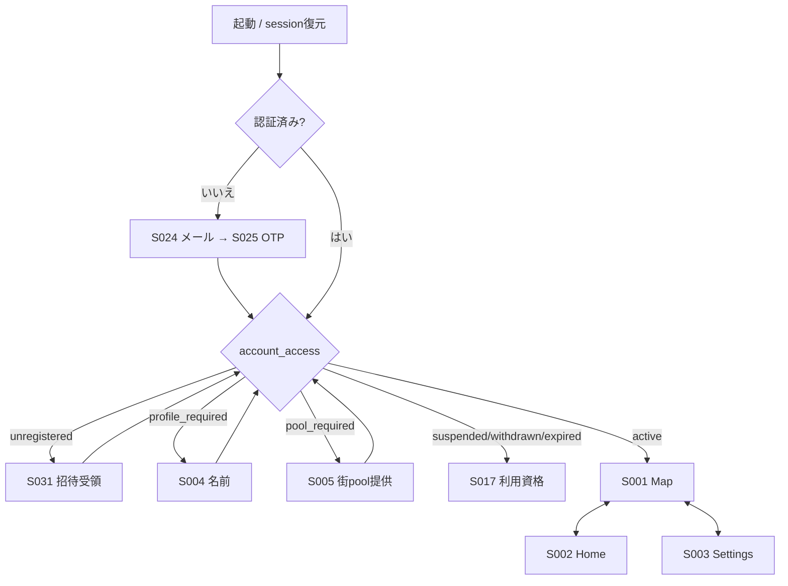

調査日：2026-11-01。対象コード：`45c089e`（本調査で製品コード変更なし）。
これは**現行実装の観察記録**であり、新しい製品仕様・デザイン案ではない。実装済みはソース上の接続の存在を意味し、全状態の実機成功を意味しない。検証事実の正本は[TECH_VALIDATION](../TECH_VALIDATION.md)、進捗は[MVP_TASKS](../MVP_TASKS.md)。

# 03 ナビゲーションと機能横断フロー

## rootとタブ

根拠：`app/_layout.tsx`、`app/(tabs)/_layout.tsx`、`hooks/useAccountAccess.ts`、`lib/sessionState.ts`。

- `Stack.key = session.revision + access.status`。identity/資格変更で画面ツリーを再生成する。別人の入力を持ち越さない。`unknown`には専用全画面ガードがない（06 G01）。
- rootの`replace`は戻るで資格前の画面へ戻らない。未認証の非`/`routeは`/`へ。初期Map。
- Home/Map/Settingsのタブアイコンは`TabIcon`、ラベル非表示。Settingsの運営入口は一般会員にも表示されるが、管理データには権限が必要。
- `events/[id]`、`recruitments/[id]`、`pins/create`、`pins/location`はStackの`presentation: modal`。その他は通常Stack。さらにRN Modal/Alert/OS UIが重なる。
- `Page`の戻るは`router.canGoBack() ? back() : replace('/')`。明示的な「未保存です」確認は全フォームに共通ではない。画面のスワイプdismissを保存・取消APIと同一視しない。

## 共通の状態保持

| 情報 | 保存場所 | 戻る/タブ切替 | 再起動 |
| --- | --- | --- | --- |
| Auth access/refresh token・セッション | Swift APIClient / Keychain | 維持 | sessionから復元。OS/認証失効時は再認証 |
| 滞在ID・更新元・seq・退出待ち | VisitLifecycle journal | UIから独立 | 退出待ちを優先。新規NFCなしに失効/終了滞在を復活させない |
| 共通command受付と送信本文 | lib/commands + SecureStore | 同じ受付へ照会 | invite/chat/event/recruitment/stickerの対応画面で復元 |
| 未送信ピン入力 | pinDraftのmodule state | 地点選択との往復で維持 | 復元なし |
| event編集・募集編集・一般フォーム入力 | hook/local state | mount/focusの振舞いに依存 | 原則復元なし |
| プロフィール・pool・参加・通知既読・block | DB/Storage | 再取得 | ログイン後再取得 |
| snapshot/chat/listキャッシュ | JSメモリ | poll/通知/再focus更新 | 再取得。古い行を無期限にmergeしない |
| TOTP秘密/確認コード | 画面メモリ | blurで消去（該当hook） | 復元なし |
| 地図移動要求 | mapNavigation module state | Mapへ一度受渡し | 復元なし |

## 個別ユーザーフロー

以下の「失敗」は現行の分岐であり、新たなエラー画面の提案ではない。項目単位は02の同ID。

| フロー | 開始条件 / 操作順序と遷移 | データ・終了状態 | 失敗/取消/再開 |
| --- | --- | --- | --- |
| F01 新規登録 | 招待コードを別途受領→S024メール→S025 OTP→S031コード入力→S004名前保存→S005写真/切抜き→S001 | Auth＋invite_accept＋profile_save＋street_icon_publish。active会員 | OTP無効はログインerror。招待無効は受領status。名前未保存/画像未提供ならrootが当該手順へ戻す。自動リンク受領はない |
| F02 再ログイン | S024→S025→資格照会 | 同メールのアカウントを再利用。通常ログインで旧端末は失効させない | 新端末は既存滞在のwriterではない。NFC再入街まで更新権限なし |
| F03 3タブ | S001↔S002↔S003 | Home参加予定/募集中、Map、設定メニュー | 取得失敗は各hookのerror/旧一覧。タブ移動でチェックアウトしない |
| F04 入街 | S001 OFF→S026説明→S027読取→S056記録→S057成功→Map | NFC tag_id→native.checkin→開始受付/commit→visit→名前付き入街ログ | explain取消は無変更。読取/記録取消はnative.stopで補償。権限要求後は再操作が必要な場合あり。開発導線はタグのみ代用 |
| F05 気配/退出 | 入街中→CoreLocation→端末判定/区画化→受理→Map表示。OFF→stop | 1滞在最新1件置換、受理成功で3h延長、気配10分。終了で募集も消える | 通信断では延命しない。退出待ち永続化でOFF維持、復帰後終了反映。静止/ロックの定時更新保証なし |
| F06 チャット | S028入力→送信、スクロール→S029過去、長押し→D014削除 | chat_post受付、chat_list最大50/回・30日、chat_delete | 送信結果不明は本文固定/受付再送、別投稿を無断生成しない。履歴の切断空白は再取得。ブロック/失効は一覧から除外 |
| F07 募集 | S018→S041題名→単発現在地→S043公開確認→S013 | recruitment_create、固定位置、20分。本人は題名編集/終了 | 未入街/非writer/測位不良/街外/同時1件は拒否。編集は期限延長しない。退出すると終了。競合は最新題名の確認 |
| F08 イベント作成 | Home/Map作成→S042→S023地点→作成に戻る→S037日時/定員→S011 | event_create受付→詳細。主催と参加登録は別 | 必須欠落/街外/期間/上限はerror。確定送信本文は受付完了まで固定。地点取消は新地点を保存しない |
| F09 参加/取消 | S011参加→Home参加予定→S011取消 | event_register(joined,registration_revision)。定員と参加人数DB判定 | 満員は参加不可、競合/通信不明は再取得。終了/中止で詳細取得不可。参加履歴なし |
| F10 主催編集/中止 | S011→S012編集→保存→詳細。中止→D003 | event_edit(event revision)、event_cancel、重要変更通知 | 開催中は終了時刻だけ。競合は現入力を維持し最新内容/置換確認。中止取消は無変更 |
| F11 参加者一覧 | 主催/運営→S011→S035 | event_roster.names。一般参加者は人数のみ | 運営はMFA不足ならAPI拒否。表示不可を空の名簿成功としない |
| F12 通知 | Settings/Pushタップ→S007→変更詳細S011、または中止既読 | notification_read→既読。変更通知は詳細へ、中止は確認のみ | 一覧はPush拒否でも利用可能。Push到達はADP未確認。通知から参加取消するとHomeから消える |
| F13 プロフィール/pool | S003→S004名前/本人写真 またはS005提供/取下げ | 写真→OS選択/切抜→圧縮→Storage→API。pool日替わり、本人用とは別 | 選択取消は無変更。アップロード失敗はerror。未公開pool24h清掃。提供取下げでもenrollmentは維持 |
| F14 ブロック/通報 | D014→ブロック またはS011/S013/D014→S019→S047 | block_set/report_create。Settings S008で解除 | 自分の表示を隠すのみ、相手から自分を隠す操作ではない。気配/人数は減らさない。通報対象消失はAPI判断 |
| F15 運営 | S003→S014→S038設定キー/ S039 6桁→管理メニュー | operator_status＋MFA＋dashboard | 一般会員は資格取得不可。認証済み一般人のAPI直呼びも拒否。通信失敗時はready=falseの場合あり |
| F16 会員・通報・招待管理 | S014→S015/S040制限/停止/解除、S016証拠/削除/解決、招待一覧無効化 | operator API。理由・期限・招待枠を保存 | 停止時は滞在/募集/主催イベント/参加登録終了。解除しても復活なし。退会済みはreadonly。通報証拠は元削除と別保持 |
| F17 ステッカー登録 | S020/S048→S049地点→S021/S051書込→S052照合→S053設置確認→S022preview→D010公開 | tag/draft/placement/area版。3点以上・非退化凸包 | fakeと実NFCを区別。不一致/未設置は公開不可。下書き7日。通信不明時再取得/同受付で再開 |
| F18 移設/交換/停止 | S022→S055/D012移設、D011交換、D013停止 | 移設は旧タグ停止、交換は公開時切替、停止は既存範囲維持 | 版競合は再取得。範囲変更だけでは全員退出しない。次の観測で最新範囲判定 |
| F19 メール変更/復旧 | S009→S033新メール→新旧コード→完了 | Auth email更新。アカウント/データは継続 | メールを失った自動復旧はMVP対象外。既存メール利用可ならOTP再ログイン。変更結果不明は現在/変更先再取得 |
| F20 退会 | S010→S034 OTP送信→D002確認→再認証/withdraw_confirm/logout | 資格停止、滞在/募集終了、主催中止、プロフィール削除/投稿匿名化/関連清掃 | 最終確認取消は削除しない。期限切れはOTP再準備。完了後の戻るで復活不可 |

## ディープリンクと通知

`app.json`に`scheme: yumegaoka`がある。Expo Routerのファイルルート自体は存在するが、招待コードURLの解釈・自動受領・サインイン後に元の任意リンクへ復帰する専用処理は見つからない。外部URLから全routeを実機で開いた検証は今回していない。

Pushは`usePushLifecycle`がnativeのopen待ちを読むと`/notifications`へ遷移する。任意の通知本文URLを実行しない。route paramsの`id/kind`はAPI認可を回避しない。不正/削除済みIDは詳細の取得エラーとなる。
