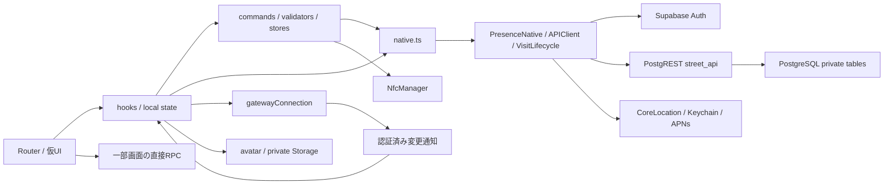

調査日：2026-11-01。対象コード：`45c089e`（本調査で製品コード変更なし）。
これは**現行実装の観察記録**であり、新しい製品仕様・デザイン案ではない。実装済みはソース上の接続の存在を意味し、全状態の実機成功を意味しない。検証事実の正本は[TECH_VALIDATION](../TECH_VALIDATION.md)、進捗は[MVP_TASKS](../MVP_TASKS.md)。

# 04 コンポーネントとロジック・データの接続

## 接続の全体像

描画部品にはUI、hooksには操作と取得、libにはAPI契約・共通状態・計算、Swiftには端末継続処理がある。**すべてが完全に分離済みではない**。下記の密結合箇所はUI差替え時の接続点であり、今回リファクタリングしていない。

## UI部品台帳

### C01 Avatar

[`components/Avatar.tsx`](<../../apps/mobile/src/components/Avatar.tsx>) — 本人/街pool画像をpathとbucketから表示。認証tokenを取得してprivate Storageへfetch、失敗fallbackを内包。UI置換時にこの取得/再認証を失わない。

### C02 EventCloudPin

[`components/EventCloudPin.tsx`](<../../apps/mobile/src/components/EventCloudPin.tsx>) — イベント雲ピンのSVG。位置/タイトル/カウントダウンの意味は呼出元。

### C03 EventDateField

[`components/EventDateField.tsx`](<../../apps/mobile/src/components/EventDateField.tsx>) — ISO日時prop⇔OS datetime spinner。編集中Dateはlocal、決定でonChange。キャンセルは変更なし。

### C04 GridBackground

[`components/GridBackground.tsx`](<../../apps/mobile/src/components/GridBackground.tsx>) — 背景格子の描画だけ。

### C05 LocationPicker

[`components/LocationPicker.tsx`](<../../apps/mobile/src/components/LocationPicker.tsx>) — MapLibre initial/onConfirm/onCancel（仮地点は内部state）。決定までDB保存なし、未選択は確定不可。

### C06 MemberRow

[`components/MemberRow.tsx`](<../../apps/mobile/src/components/MemberRow.tsx>) — 会員情報＋独立展開フォーム。useMemberActions、Alert、日時選択が接続済み。

### C07 Page

[`components/Page.tsx`](<../../apps/mobile/src/components/Page.tsx>) — Page/Action/Emptyの3export。ScrollView/戻る/無効ボタン/空表示。画面単位のAPI処理は持たない。

### C08 PinListItem

[`components/PinListItem.tsx`](<../../apps/mobile/src/components/PinListItem.tsx>) — Homeのタイトル・補足・地図ボタン。detailとMapの別callback。

### C09 PresenceHeader

[`components/PresenceHeader.tsx`](<../../apps/mobile/src/components/PresenceHeader.tsx>) — 有効気配画像と+残人数。実測widthとbadgeWidthをvisiblePresenceIconsへ渡す。チェックイン人数とは別。

### C10 StreetChat

[`components/StreetChat.tsx`](<../../apps/mobile/src/components/StreetChat.tsx>) — 表示・拡大・スクロール・キーボード・長押しメニュー。composer/chat hookとrouterが密接。

### C11 StreetEntrySheet

[`components/StreetEntrySheet.tsx`](<../../apps/mobile/src/components/StreetEntrySheet.tsx>) — explain/scanning/checking/success。cancel意味が段階で異なる、closeを単なるdismissに置換不可。

### C12 StreetLogin

[`components/StreetLogin.tsx`](<../../apps/mobile/src/components/StreetLogin.tsx>) — email/code/sent/busy/errorの表示と親login callback。認証処理自体はhook/native。

### C13 StreetMapMarkers

[`components/StreetMapMarkers.tsx`](<../../apps/mobile/src/components/StreetMapMarkers.tsx>) — liveCellsの気配、イベント、募集。ピンdetail callback、同区画の描画offset。個人IDを付けない。

### C14 TabIcon

[`components/TabIcon.tsx`](<../../apps/mobile/src/components/TabIcon.tsx>) — Home/Map/SettingsのSVGと選択色。業務処理なし。

## hooks台帳

| ID | ファイル / hook | 再利用する責務 |
| --- | --- | --- |
| H01 | [`hooks/useAccountAccess.ts`](<../../apps/mobile/src/hooks/useAccountAccess.ts>) | 認証後の会員/停止/プロフィール/poolチェック、Context。10秒/前景更新。rootガードと結合。 |
| H02 | [`hooks/useChatComposer.ts`](<../../apps/mobile/src/hooks/useChatComposer.ts>) | 送信本文/受付の復元、結果不明時の固定、取消照会。textを単純なUI stateへ戻さない。 |
| H03 | [`hooks/useEmailChange.ts`](<../../apps/mobile/src/hooks/useEmailChange.ts>) | Auth変更申請/新旧確認、結果不明後の再取得、blurコード消去。 |
| H04 | [`hooks/useEventDetail.ts`](<../../apps/mobile/src/hooks/useEventDetail.ts>) | event取得/参加/取消/中止/名簿。revision、重複操作防止、最新再取得。 |
| H05 | [`hooks/useEventEditor.ts`](<../../apps/mobile/src/hooks/useEventEditor.ts>) | dirty入力、validation、開催中の制限、競合時latest。router戻りと結合。 |
| H06 | [`hooks/useHomePins.ts`](<../../apps/mobile/src/hooks/useHomePins.ts>) | 参加イベント・募集の取得/期限除外、focus/poll/変更通知。 |
| H07 | [`hooks/useInvitations.ts`](<../../apps/mobile/src/hooks/useInvitations.ts>) | 受領、発行command、履歴、共有、取消。Shareと資格Context依存。 |
| H08 | [`hooks/useMemberActions.ts`](<../../apps/mobile/src/hooks/useMemberActions.ts>) | 会員操作の入力検証・理由・API・保存後callback。 |
| H09 | [`hooks/useMembers.ts`](<../../apps/mobile/src/hooks/useMembers.ts>) | 一覧100件cursor、展開状態、再取得。 |
| H10 | [`hooks/useModeration.ts`](<../../apps/mobile/src/hooks/useModeration.ts>) | 通報一覧/削除/解決、再取得とstreetChanges。 |
| H11 | [`hooks/useNotifications.ts`](<../../apps/mobile/src/hooks/useNotifications.ts>) | 一覧/既読/詳細への移動。router依存、Push許可とは別。 |
| H12 | [`hooks/useOperatorDashboard.ts`](<../../apps/mobile/src/hooks/useOperatorDashboard.ts>) | 資格/MFAfactor/秘密/6桁/運営概要/招待pagination。secretのblur消去。 |
| H13 | [`hooks/usePinCreation.ts`](<../../apps/mobile/src/hooks/usePinCreation.ts>) | draft/受付復元、募集測位、event validation、送信結果/詳細replace。 |
| H14 | [`hooks/useProfile.ts`](<../../apps/mobile/src/hooks/useProfile.ts>) | 名前/本人画像の取得/保存、status、資格再判定。 |
| H15 | [`hooks/usePushNotifications.ts`](<../../apps/mobile/src/hooks/usePushNotifications.ts>) | usePushLifecycleとusePushPermission。root sessionとOS token登録、tap→通知一覧、許可状態。 |
| H16 | [`hooks/useRecruitmentDetail.ts`](<../../apps/mobile/src/hooks/useRecruitmentDetail.ts>) | 題名dirty/期限/編集/終了/競合、pollと再取得。 |
| H17 | [`hooks/useStickerDetail.ts`](<../../apps/mobile/src/hooks/useStickerDetail.ts>) | DB下書き工程・NFC adapter・編集revision、離脱世代ガード。 |
| H18 | [`hooks/useStickerRegistration.ts`](<../../apps/mobile/src/hooks/useStickerRegistration.ts>) | 登録command復元、タイトル/point、一覧/取消。 |
| H19 | [`hooks/useStreetChat.ts`](<../../apps/mobile/src/hooks/useStreetChat.ts>) | 履歴cursor/空白回復/削除/ブロック、gateway変更通知、会員更新。 |
| H20 | [`hooks/useStreetMap.ts`](<../../apps/mobile/src/hooks/useStreetMap.ts>) | 認証・入街・NFC・退出・snapshot・pin取得・clock・gatewayを束ねる。sheet stateと密結合。 |
| H21 | [`hooks/useWithdrawal.ts`](<../../apps/mobile/src/hooks/useWithdrawal.ts>) | 再認証受付/OTP/確定/logout。段階refで同一画面再試行。 |

## UI非依存処理 / 共有状態

| ID | ファイル | 役割 |
| --- | --- | --- |
| L01 | [`lib/avatar.ts`](<../../apps/mobile/src/lib/avatar.ts>) | chooseAvatar/chooseStreetIcon: OS選択、正方形編集、JPEG圧縮/Storage公開。imageErrorMessageはUI文言が含まれる。 |
| L02 | [`lib/chatWindow.ts`](<../../apps/mobile/src/lib/chatWindow.ts>) | readChatWindow: cursorで表示窓を再取得し欠落/削除/ブロック反映。 |
| L03 | [`lib/commands.ts`](<../../apps/mobile/src/lib/commands.ts>) | submitCommand等: SecureStore保存、受付10分/結果最小24h、未確定本文の再送と取消。 |
| L04 | [`lib/development.ts`](<../../apps/mobile/src/lib/development.ts>) | localHost/localEntry/nfcDisabled: local環境かつ明示flagで代替。 |
| L05 | [`lib/eventInput.ts`](<../../apps/mobile/src/lib/eventInput.ts>) | eventInputError: 題名/説明/日時/定員/地点の入力検証。 |
| L06 | [`lib/events.ts`](<../../apps/mobile/src/lib/events.ts>) | StreetEvent型/countdown: 表示のみ。長時間は日/時間、短時間m:ss。 |
| L07 | [`lib/gatewayConnection.ts`](<../../apps/mobile/src/lib/gatewayConnection.ts>) | アカウント/セッション付き変更通知接続、前景/再接続/close。本文をbroadcastしない。 |
| L08 | [`lib/jpegMetadata.ts`](<../../apps/mobile/src/lib/jpegMetadata.ts>) | stripJpegMetadata: EXIF/XMP/Photoshop/comment除去。 |
| L09 | [`lib/localBlocks.ts`](<../../apps/mobile/src/lib/localBlocks.ts>) | 非表示対象の即時反映、変更通知。正本はDB。 |
| L10 | [`lib/mapNavigation.ts`](<../../apps/mobile/src/lib/mapNavigation.ts>) | 一覧/詳細→Mapの座標移動要求。 |
| L11 | [`lib/mapStyle.ts`](<../../apps/mobile/src/lib/mapStyle.ts>) | style URLの選択（envまたはOpenFreeMap）。業務データではない。 |
| L12 | [`lib/member.ts`](<../../apps/mobile/src/lib/member.ts>) | Member型。 |
| L13 | [`lib/native.ts`](<../../apps/mobile/src/lib/native.ts>) | Swift bridge型/呼出し、Auth変更をsessionStateへ反映、displayClock。 |
| L14 | [`lib/pinDraft.ts`](<../../apps/mobile/src/lib/pinDraft.ts>) | module storeとusePinDraft。未送信入力はメモリのみ。 |
| L15 | [`lib/presence.ts`](<../../apps/mobile/src/lib/presence.ts>) | 期限グループ→liveCells、描画分割/offset/fade。 |
| L16 | [`lib/presenceHeader.ts`](<../../apps/mobile/src/lib/presenceHeader.ts>) | visiblePresenceIcons: アイコン幅/余白/+バッジ実測から個数。 |
| L17 | [`lib/recruitments.ts`](<../../apps/mobile/src/lib/recruitments.ts>) | Recruitment型。 |
| L18 | [`lib/sessionState.ts`](<../../apps/mobile/src/lib/sessionState.ts>) | 共有Auth状態/購読/revision。画面キーの基礎。 |
| L19 | [`lib/stickers.ts`](<../../apps/mobile/src/lib/stickers.ts>) | StickerDraft型/stickerTouch実NFCまたはlocal adapter。 |
| L20 | [`lib/streetChanges.ts`](<../../apps/mobile/src/lib/streetChanges.ts>) | 同プロセスの内容なし変更通知、各画面が自分の権限で再取得。 |

## 直接接続が残る場所（変更候補の特定のみ）

| 場所 | 現在の密結合 | 置換時に維持する境界 |
| --- | --- | --- |
| app/street-icons.tsx | pool取得/30秒更新/画像選択/削除/初回資格判定が画面内 | chooseStreetIcon、street_icon_get/removeとaccess.retryの成功順 |
| app/blocks.tsx | 一覧/解除/排他ref/ローカル非表示更新 | DB成功後localBlocks、再取得。匿名気配を減らさない |
| app/report.tsx | localフォームとreport_create直接呼出 | kind/id/reason/description、sent/error、通報者非公開 |
| app/stickers/area.tsx | preview/publish/placement操作とModal/Alertが同居 | expected revision、公開前preview、移設/交換の異なる停止時点 |
| Avatar | 認証付き画像fetchとfallback | private Storageを公開URLへ勝手に変更しない |
| useStreetMap/StreetChat | UI状態(sheet/scroll)とnative/履歴が同居 | 読取取消と退出、チャット表示窓復元を視覚変更で失わない |
| usePinCreation/Detail系hook | 操作後router操作を含む | 成功後遷移、未確定受付の破棄禁止。異なるナビ実装にする場合adapterが必要 |

## Swift / 端末境界

`apps/mobile/modules/presence-native/ios/`：

- `PresenceNativeModule.swift`：JSへ公開する関数とonChange。現在地、Auth、滞在、Push。
- `PresenceEngine.swift`：CoreLocation、permission、foreground/background、観測送信と状態表示。
- `ObservationCore.swift`：100m区画、測位精度、最新2分、時計補正、境界判定。
- `VisitLifecycle.swift`：受付/commit/seq/終了優先/再起動journal。トグルはこの状態の投影。
- `APIClient.swift`：Auth、refresh、Keychain、RPC/HTTP、再送用情報。UIがtokenを個別管理しない。
- `PushNotifications.swift`：許可/端末token/登録/通知tap。実APNsは外部条件待ち。
- `ServiceError.swift`：認証等のエラー分類。`TemporaryImageCleanup.swift`：画像一時ファイル清掃。

NFCは`useStreetMap.scan`と`lib/stickers.stickerTouch`からNfcManagerへ。画像はExpo ImagePicker/Manipulator/FileSystem。地図はMapLibre。これらはExpo Goだけで成立する構成ではない。

## DBレスポンスとUIの対応

下表は実際の型/SQLで確認した読取モデル。ID/revision等は通常画面に表示しなくても操作に必須。PostgreSQL private tableへUIから直接書かず、`native.rpc(operation,payload)`→`street_api`を使う。SQLの同名関数は後のmigrationで置換されるため、最初の定義だけを正本にしない。

| 読取 | フィールド（型） | 表示/用途・画面 | SQLの根拠 |
| --- | --- | --- | --- |
| account_access | status enum, chat_restricted_until timestamp? | root/S017/S028の投稿制限 | 022/028 |
| profile_get | display_name string, avatar_path string?, avatar_updated_at timestamp?, avatar_upload_path string | S004/Avatar。upload_pathは非表示 | 001/016 |
| street_icon_get/publish | contribution_id/path nullable, daily_path nullable, contributed bool, day string, next_shuffle_at timestamp | S005提供/当日表示。contributedはroot、next_shuffle_atは通常非表示 | 023/024/031 |
| get_presence_snapshot | server_time timestamp, street_id uuid, checked_in_count/presence_count number, cells[] | S001/header/markers | 025 |
| cells | cell_id/area_version/grid_version string, anchor{lng,lat}, count number, expiry_groups[{expires_at,count,icons}] | 端末公開集約から描画。TS型はcountなどSQL全項目を宣言していない。個人token/名前を含めない | 025 |
| get_my_visit | visit_id/street_id/state/can_update/expires_at/last_seq | トグル/募集権限、非表示の更新管理 | base/後続visit migrations |
| event_get/event_list.items | id,street_id,title,description,longitude,latitude,starts_at,ends_at,capacity,revision,mine,count,joined,registration_revision | S001/S002/S011/S012。host名の表示フィールドなし | 006 event_view /017 event_api |
| event_roster.items | account_id uuid, display_name string | S035は名前だけ表示 | 017 |
| recruitment_get/list.items | id,title,longitude,latitude,expires_at,revision,mine,author_id,display_name | S001/S002/S013、author_idはblock用 | 007 |
| chat_list.items | id,author_id?,display_name,avatar_path?,avatar_updated_at?,body?,created_at,deleted,kind,mine | S028/S029、現在profileで過去投稿も表示 | 003/016 |
| invite_list.items | id,expires_at,used,revoked（実型名は07該当hook参照） | S006の状態表示。残り招待枠の数値フィールドなし | 002 |
| notification_list.items | id,event_id,kind,title,created_at,read | S007。Push受信だけで既読にしない | 017 |
| block_list.items | account_id,display_name | S008解除対象 | 003 |
| operator_status/dashboard | operator bool / active_members,active_invitations number | S014資格と概要 | 009 |
| operator_invites.items | id,issuer,issuer_name?,used_by?,recipient_name?,created_at,expires_at,used_at?,revoked_at? | S014名前/状態/期限。created_at/id cursor | 009/032 |
| operator_members.items | account_id,active,withdrawn_at?,display_name,weekly_limit,invite_paused,chat_restricted_until? | S015/S040制限フォーム | 030 |
| operator_reports.items | id,target_kind,target_id,reason,description,evidence,created_at,review_due | S016は証拠/理由/整理対象、created_at/通報者表示なし | 010/012 |
| sticker_get/list.items | id,tag_id,title,phase,revision,longitude,latitude | S020/S021/S022工程、版は非表示 | 014 |
| placement_list.items | tag_id,title,longitude,latitude,revision,active,retired | S022表示と移設/交換/停止payload | 015 |
| sticker_preview | valid bool, boundary GeoJSON,版情報 | S022valid時polygon/公開。版は内部 | 015 |

完全な型定義と各RPC呼出箇所は07。日時はAPI ISO8601→`toLocaleString`等、日時入力はISOへ戻す。現在の表示フォーマットを新しい承認済み仕様と誤認しない。
