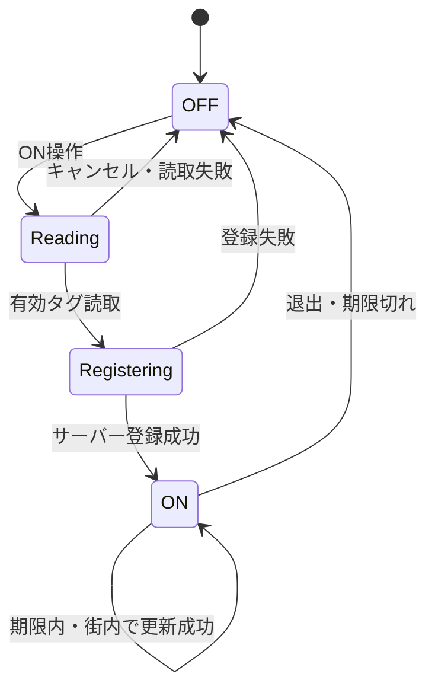

> 履歴資料。2026-10-29整理前の記録であり、現在の実装仕様ではない。[現行文書の入口](../README.md)を参照。

# 画面・ユーザーフロー設計レビュー v0.1

日付：2026-10-28。Figma書き出し8枚とトグル追加の修正版、ユーザーの説明・追記を基にしたレビュー。コード実装・実機検証・利用者テストは未実施。

## 1. 最新の目的と設計の前提

**「街の人の気配を感じることができる、孤独な人間のための第六感」**。

人数・チャット・募集一覧だけでは十分ではない。画面を眺めた時点で、発言や募集を読むことなく街に人がいると感じられる気配表示をMVPの中心に加える。

ユーザーが明確にした方向：
- マップ上の気配は名前なし。10分で薄くなり消える。募集ピンの20分とは別。
- チャットは特定の誰かわかることを重視し、名前付き入街ログで友人の来訪を認識できるようにする。
- 人の移動に追従する位置の継続共有は行わない方向を維持する。
- 入街／退出はヘッダー右上のトグル。ON操作でNFC、OFF操作で退出。
- アイコンを流動化し、特定人物の固定的な見た目にしないことを希望する。

新規の仕組みを既存要件から自動的に導かれたものと扱わない。気配の生成契機・精度・集約・アイコン受け渡し・Bluetoothは方式未決定。以下の設計案は承認前の案。

## 2. 目的との整合性

### 強く一致する点

- 地図上で人の気配を先に感じ、必要なときだけチャットや募集を使う構成は、Spaceを主役にできる。
- チェックインは街に参加する行為、募集は合流の意思表示として分けられる。気配があることを「会いたい」と同一視しない。
- 10分で消える気配は、過去の投稿を積み上げるより、その場の変化を感じる設計に向いている。
- チャットを広げる操作は、眺める状態から話す状態へ利用者自身が切り替える構造にできる。
- NFCを入口の儀式にすることやアイコンの受け渡しは、文化の象徴になり得る。ただし文化が成立するかは実地で検証する仮説。

### 調整が必要な点

- 名前付き入街ログはユーザーが選んだ方針。入街を人に知られず過ごせる保証とは両立しない。人数変化・時刻・地図の気配を照合すると、名前なしの気配でも本人を推測できる。表示上の匿名と追跡不能を区別する。
- 名前が固定なら、アイコンだけ変えても特定人物への認識や好き嫌いは消えない。嫌な相手から距離を取るにはブロック等が別途必要。
- ユーザーがアイコンを登録する以上、本人がこだわらないとは仮定できない。他人のアイコンが自分の発言に付くと、なりすましや発言者の誤認が起きる。
- 初期の人数が少ないと10分の気配が消えて地図が静かになる。架空の人を足して賑わいを捏造しない。気配のない状態も意味を持たせる必要がある。
- 「ここに2人います」は現在の正確な観測に見える。短命の過去データなら「このあたりに最近2人の気配」など、意味に合う表現を提案する。痕跡を残してもそこに留まる義務を作らない。

目的に沿うかは画面の分析として評価できるが、孤独感・安心感・文化形成の実効性をこのレビューで証明したとはしない。

## 3. 画面インベントリと変更点

| 参照 | 読み取った画面 | 設計で詰める点 |
| --- | --- | --- |
| [76](../reference/ui/iphone-17-76.png)、[修正版](../reference/ui/map-toggle-correction.png) | 地図、アイコン列、気配の集まり、募集・オフ会、チャット、3タブ | 気配のデータ根拠。アイコン列は本人一覧か流動的な街の表現か。総人数も明示する |
| [77](../reference/ui/iphone-17-77.png) | 地図の地点選択 | 「ここにする」「キャンセル」、下書き保持、戻った時のカメラ保持 |
| [78](../reference/ui/iphone-17-78.png) | 募集作成シート | 題名、現在地の確認、20分公開、位置拒否、チェックイン必須、二重送信防止 |
| [79](../reference/ui/iphone-17-79.png) | オフ会作成シート | 場所選択往復、開始終了、説明、未入力・不正日時、公開成功 |
| [81](../reference/ui/iphone-17-81.png) | Homeのピン一覧 | 「参加予定」は新しい概念。保存／参加表明／開催予定のどれか未決定。画像の第3タブは未定義 |
| [82](../reference/ui/iphone-17-82.png) | NFC待機の独自シート | iOS標準読み取りシートが別に必要。独自待機シートと二重に操作させない |
| [83](../reference/ui/iphone-17-83.png) | NFC検知後・登録中 | タグ読取完了後のサーバー処理はタグから離れてよい。「離さず待つ」は読書き中のみ |
| [84](../reference/ui/iphone-17-84.png) | チェックイン成功 | サーバー成功後に表示。トグル・人数・気配・入街ログを整合させる |

歌舞伎町・多摩川など画像のサンプルは初期実験地域の変更指示とはしない。DreamCloud、電信結界、夢ヶ丘の用語を統一するかは別途確認。

## 4. 推奨する画面と状態遷移（案）

### 地図を眺める

推奨は起動後にMapを表示し、Homeは予定を確認する補助画面にすること。最初の表示タブは未決定。Home／Map／Settingsの3タブ構成はユーザー提示を採用する方向。

Mapでは街名・総チェックイン数・トグルを維持。アイコン列は名前一覧でないことを見た目と説明で区別する。現在地ボタンは自分の地図を中心へ戻すだけで、共有・チェックインを発生させない。

一人ずつの位置を示すような架空のランダム点を地図上に生成しない。気配データがないときは「最近の気配はありません」等を静かに表示し、エラー・未取得・0を区別する。ヘッダーが17人でも10分の痕跡が0になることはあり得る。

### 入街・退出

ON操作直後はON確定ではなく、読取／登録中の状態にする。サーバー成功前に人数を増やしたり成功チェックを出したりしない。OFFは退出意思を即反映し、通信がなければ未送信状態を明示。旧い更新が届いても復帰させない。

気配と入街ログを生成する場合はチェックイン成功イベントから一回だけ発生させ、NFCの再読取や通信再送で二重発生させない。入街はアカウントログインと用語を分ける。期限延長では入街ログやアイコン交換を繰り返さない案。

### チャットを読む・話す

Map下部に縮小チャット。上方向へ意図的にドラッグ／拡大操作 → 拡大チャット＋背景ぼかし。拡大後は過去30日のスクロール。下げる／閉じるで地図へ戻る。スクロール量ごとに拡縮を繰り返さない。

入力フォーカスでも拡大しキーボードを避ける。過去を読んでいる最中に新着で最下部へ飛ばさず、「新着」導線を出す。ぼかしの背面では地図操作を停止。小さい画面・文字拡大・透明度軽減では単色の背景等で可読性を確保する。

ユーザー名・投稿日時・本文・アイコンを表示。入街システムログは通常発言と別の見た目にし、利用者が偽装できない種類にする。通報・削除・ブロックは見た目のアイコンでなく、安定した投稿者IDへ適用する。ログ保持を通常チャットと同じ30日にするかは未決定。

### 募集を作る

MapまたはHomeの作成 → 作成シートの募集タブ → 有効チェックイン確認 → 単発測位 → 表示位置・公開内容確認 → 題名 → 公開 → Mapの募集地点へ。

未チェックインなら下書きを保持してNFCへの導線を示す。位置拒否・取得失敗なら公開不可。送信中は重複操作を防ぐ。同時1件の既存募集があればその管理画面へ誘導する案。募集の位置は公開後に移動しない。20分または終了・チェックアウトで消える。

### オフ会を作る

作成シートのオフ会タブ → 題名・日時・説明を編集 → 場所選択 → 全画面Mapを動かす → 仮の地点をタップ → 「ここにする」 → 元の下書きシート → 内容確認 → 公開。

地図選択で即公開しない。キャンセル時は元の地点と入力を保持。日付をまたぐ終了も選べるようにし、終了が開始以前の場合は説明を表示。過去日時、90日先／24時間の上限も検証する。

開催までMM:SSは1日先の予定で読みにくい。1時間以上は「あと2時間」「明日20:00」、1時間未満はMM:SS、開催中は残り時間という案。タイマーは端末側で表示更新し、秒ごとのサーバー通信は不要。終了の可否はサーバーの時刻で扱う。

### Homeと設定

Homeはピン一覧。名前が「参加予定」なら、一覧に入れる操作と参加取消・公開範囲が必要。最小案は本人だけの「保存した予定」で、主催者への参加通知・名簿・出欠管理を伴わない。ただし未承認。自分の開催予定なのか単に近日開催なのかも確認する。

Settingsにはプロフィール、メール／アカウント、招待、ブロック、ログアウト・アカウント削除。運営ロールのNFC基本設定・移設・通報等へ遷移する案。これらの画面は添付にないので別途作る。

## 5. 気配の実装案：まずデータの意味を決める

気配・募集・チェックインは別の情報である。

| 情報 | 意味 | 期限 |
| --- | --- | --- |
| チェックイン人数 | 街に参加している有効セッション数の目安 | 更新から3時間 |
| 気配 | ある時点にある場所にいたことの短い痕跡 | 10分 |
| 募集ピン | この公開地点で合流したいという意思 | 20分 |
| オフ会ピン | 指定場所・時間の予定 | 開催終了 |

### 第一案：NFCチェックイン時に一度だけ気配を残す（未承認）

既知のステッカー設置地点付近に短命の気配を残す。新たなGPS送信・Bluetoothを要さず、移動追従も行わない。位置は正確な個人の現在地ではなく「この入口付近に最近人が来た」痕跡とする。ステッカーの移設で既存の痕跡を新位置へ移動させず、生成時の地点に固定する。

10分間の一度きりのスナップショットであり、現在そこにいる保証はない。街の奥へ移動した人の気配は描けず、10分新規入街がなければ地図の気配は消える。この弱点を隠さずユーザーが体験として十分か判断する。募集がなくても気配を出すことが目的なので、募集データだけを気配に流用して代替したとはしない。

### 別案：明示したタイミングの単発位置から気配を残す（未承認）

一度のGPSスナップショットを粗いエリアに変換して残す。チェックイン時の自動生成か、本人が気配を残す操作かを決める。ユーザーに生成・公開の意味を示す。前面復帰ごとに自動生成すると、断続的でも行動履歴を集めることになるため、既存の位置を送らない更新とは分離して承認を得る。

エリア単位なら合流用の正確な地点ではないと表示。どの粒度でも小人数や入街ログからの推測はあり、匿名性の保証にはならない。

### 集約と消滅の案

- 各気配は一意のイベントID、生成時刻、失効時刻、エリア、気配用ビジュアルを持つ。公開データにはアカウントIDやユーザー名を載せない案。内部の制限・終了処理用の対応付けは別管理。
- 同じ滞在からの重複気配を増やさない。生成の再試行も同じイベントとして扱う。再生成を許す場合も古い気配を置換し、移動経路を積み上げない。
- 透明度は生成時刻から10分で0にする。一定周期のサーバー更新は不要。サーバーも期限切れを返さず、端末のタイマーだけに依存しない。
- 二つの気配が集まる表示なら、各イベントの年齢を維持する。新しい人が来ても古い人の10分をリセットしない。古い気配が消えれば人数を減らす。
- MapLibreのクラスタは画面上の近い点をまとめる表示機能であり、20m以内やBluetoothの実測人数を保証しない。表示文言は観測内容に合わせる。
- 退出・ブロック・通報時の非表示とサーバーからの削除は別途決定。終了した気配の長期保存は提案しない。第三者の取得済みデータは消せない。

## 6. Bluetooth案の評価

BLEの受信強度から「近そう」は推定できても、汎用端末で20mを厳密な境界として保証しにくい。壁・階・ポケット・機種で変わる。iOSにはバックグラウンド走査・広告の制約、Androidには権限等の要件があり、両OS混在での自動発見は実機検証が必要。

Bluetooth検知そのものは緯度経度を返さない。二人の位置の平均を求めるには、別途GPSと二人の情報交換・公開許可が必要。平均点が建物の中や道路中央等になり、会える場所とは限らない。AがBを、BがCを検知してもAとCが近いとは限らず、グループの定義・重複報告・退出・一方だけ許可拒否・古い座標の扱いも増える。

匿名化としても、平均mと一人の座標aがわかれば、もう一人の座標は2m-aで求められる。単純な平均は匿名性を保証しない。

MVPの気配自体は必須として扱い、Bluetoothは方式候補として保留を推奨する。第一案の痕跡で体験が足りない場合に、生成契機の拡張を比較する。気配を外す提案ではない。

## 7. アイコンの受け渡し案の評価

### NFCに前の人の名前を書き込む方式の問題

- 公開のタグから前の来訪者名を第三者が読める。名前検索のAPIがアイコン収集の入口にもなる。
- 一般利用者全員に書き込みを要求し、タグの読取専用化・書込保護方針と衝突する。
- 前の人を読む → 自分を書く → サーバーへ参加する、は一つのトランザクションにできない。書き込み成功後に通信が失敗した場合などの整合が必要。
- 連続読み取り、前の人が退会・停止・画像削除、最初の利用者、自己連続タッチ、別街での利用、悪意ある名前書き込みへの対応が必要。
- 前の人から受け取るのは順番による受け渡しで、ランダムではない。自分の登録画像と、その人が現在借りている画像のどちらを受け取るのか曖昧。後者なら同じ画像が伝播し続ける可能性がある。
- 名前付きログとの照合で誰の絵か推測できる。流動化自体が匿名化を保証するわけではない。

### 意図を残す代案（未承認）

プロフィールの本人アイコンと、地図上の気配に割り当てる「街のアイコン」を分離する。気配用は共通素材または参加者が明示的に提供した素材プールから割り当て、顔の所有者がそこにいると誤認させない。プロフィールの画像を他人の発言へ無断で付け替えない。

「前の人から受け取る」体験を残したい場合は、タグにはIDだけ置き、サーバーでタグごとの前回情報と割当を管理する。チェックイン成功時に一度だけ更新し、画像の見つからない場合は共通素材を使う。NFC読書きの二重操作は不要になるが、サーバーに来訪順の対応が生じるため保存を最小化し、履歴を積み上げない。

チャットでも借りたアイコンを使いたい場合は、安定したユーザー名・本人プロフィールへの導線・借用である表示が必要。メッセージ投稿時の割当を固定し、再入街のたびに過去発言の絵まで変わらないようにする案。通報・ブロックの主体は常に本人ID。地図だけを流動化する案と比べ、発言者誤認のリスクが増す。

## 8. UI上の具体的な改善候補

- アイコン列の「+11」だけに人数を任せず総数を明示する。未取得や接続切れを0人と表示しない。
- Mapタブの青い背景が全画面で固定だと、Home選択中もMapが選択されて見える。アクティブ状態を一つにし、必要ならラベルを付ける。
- 薄い灰色のフォーム文字は無効状態に見えやすい。入力ラベルを残し、placeholderと無効化と未入力を区別する。文字サイズ拡大でもスクロールとボタンへ到達できるようにする。
- 独自ピンや大きな吹き出しは地図を覆う。ズームでラベル密度を調整し、タップで詳細を開く。気配のクラスタと募集ピンのクラスタを混ぜない。
- タイマーや気配のopacityは端末で描画更新。多数のReact Viewを秒ごとに全再描画しない。MapLibreのレイヤー・点数制限を評価する。
- 過去日時は日付も表示する。00:22:09だけでは30日履歴のどの日か不明。気配の時刻を名前付き入街ログに結び付けない見た目でも、相関そのものは消えない。
- 10分で消すのは気配のみ。ユーザーが参加者一覧・チャット・募集まで10分で消えると誤解しない説明を設ける。

## 9. 検証計画

設計の目的適合を確かめる観点（未実施）：

1. 発言・募集しなくても、数秒眺めて人の気配があると理解できるか。
2. 気配を見た人が「今必ずそこにいる」「会ってよい」「知っているアイコンの本人だ」と誤認しないか。
3. 入街ログで友人に気づける一方、返信・合流・滞在継続の義務を感じさせていないか。
4. アイコン流動化で発言者の認識や通報・ブロック操作を間違えないか。
5. 0人、1人、少人数、10分後の消滅、3時間の失効を見て表示の意味がわかるか。
6. NFCキャンセル・通信失敗・位置拒否・投稿途中の期限切れ・画面復帰で状態が一致するか。
7. 作成シートと地図の往復で入力を失わず、チャットの拡大・縮小と地図操作が競合しないか。

これは追加インタビューを開発前提にする計画ではない。仕様承認後のプロトタイプ・初回実地試験で観察する。

## 10. 次に確認すること

- 気配はいつ生成するか。NFC入街時の地点だけでよいか、街の中で別途残せる必要があるか。
- アイコンの流動化は地図のみか、チャットも必須か。提供者の画像利用への同意・割当方法。
- 「参加予定のピン」は保存・参加表明・開催予定一覧のどれか。
- 入街ログの保持期間、地図の気配が退出時に消えるか、ブロック時の非表示対象。

## 一次資料

- Apple Bluetoothの背景処理制約：https://developer.apple.com/library/archive/documentation/NetworkingInternetWeb/Conceptual/CoreBluetooth_concepts/CoreBluetoothBackgroundProcessingForIOSApps/PerformingTasksWhileYourAppIsInTheBackground.html
- Apple iBeacon近接推定の限界：https://developer.apple.com/documentation/corelocation/determining-the-proximity-to-an-ibeacon-device
- Android Bluetooth権限：https://developer.android.com/develop/connectivity/bluetooth/bt-permissions
- MapLibre GeoJSONクラスタ：https://maplibre.org/maplibre-react-native/docs/components/sources/geo-json-source/
- Apple NFC読み取り：https://developer.apple.com/documentation/corenfc/building-an-nfc-tag-reader-app
- Apple NFC書き込み：https://developer.apple.com/documentation/corenfc/nfcndeftag/writendef(_:completionhandler:)

公式資料はAPIや制約の根拠。文化・心理効果の評価や推奨案はこのプロジェクトへの設計上の推論。

## 最新の追加合意

地図は流動的な街アイコン、チャットは本人名・本人アイコンに分離。NFCは名前の書き込みを避け識別情報を使う。移動先でも気配が生まれることが必須であり、入口の一回の痕跡のみでは不足。Homeの参加予定はオフ会詳細から「参加する」で登録するイベント参加。方式とイベント管理の範囲は [PRESENCE_AND_EVENTS.md](../PRESENCE_AND_EVENTS.md) で検討中。従来の未決定表記はこの合意を優先する。
